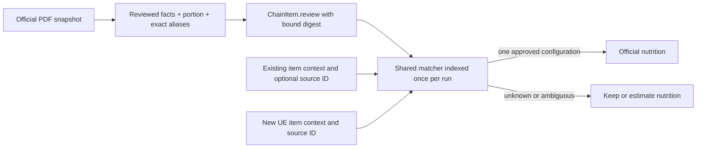

# Reviewed chain matching

> **Status:** Shared matcher; data approval remains separate

**TL;DR:** Reviewed exact servings feed both ingestion paths; source IDs and allulose require bound source evidence.

A legacy `official/HIGH` row is not sufficient evidence for a serving override.
WaBa's old `chicken` row contained a family portion while its alias named a single plate.

`ChainItem.review` is optional JSON so its migration leaves existing rows unreviewed.
Its typed payload records the source SHA-256, table locator, reviewer, and exact menu aliases.
A second digest binds those fields to the brand, canonical key, serving, all four macros, source URL, and confidence.
Editing any of those requires a new review.
Locator/reviewer edge whitespace is cosmetic and normalized before hashing.
This is an integrity check, not a cryptographic signature.

Matching preserves parenthetical sizes and the complete section/description.
Only case and whitespace are normalized.
A name without its reviewed context does not inherit nutrition.
Duplicate candidate configurations abstain.
Missing, negative, non-finite, or grossly inconsistent nutrition cannot become an approved match.
An alias may additionally pin a provider-qualified `sourceItemId`; that ID is case-sensitive and cannot replace the full reviewed context.
Disjoint ID-specific servings may coexist, while a conflicting generic alias remains ambiguous.
Source-less historical aliases retain their original approval hashes.
The energy check allows the larger of 60 calories or 20% for label rounding; it is a sanity check and does not replace source review.
Explicitly published allulose grams use 0.4 kcal/g in the energy check, while published total carbohydrate remains unchanged.
The allulose grams and source locator are review-bound; absent evidence preserves the ordinary energy check.
An explicit UE calorie range or a source calorie disagreement above the larger of 30 calories or 5% prevents an override unless the exact range has a reviewed default serving.
These are source labels, not the existing estimated MenuItem columns.
Both the markdown and direct UE JSON parsers preserve source labels and ranges.
The shared adapters supply reviewed macros to existing-menu updates and new imports.
Customization metadata does not select a meal configuration.

An approval with no aliases indexes no items; source facts can be reviewed before menu bindings.
Aliases are reusable across locations with the same configuration and any required source ID.
They are indexed once per run; an item match makes no database, network, or LLM call.
The caller must supply a verified brand ID.
The API serving path does not run this matcher.

The shared source priority remains merchant > reviewed official > retained historical published sources > estimates, in both SQL and TypeScript.
Retiring a provider does not rewrite its stored estimates or change the compatibility ranking in `macroProvenance.ts`.

Catalog code alone does not change serving data.
Pipeline and existing-menu update adapters both call this module; existing-menu updates preserve Fitsy IDs and metadata.
Source tables, unknown customizations, and disputed facts remain subject to review.

See the [proposal-only LA rollout runbook](chain-rollout-proposals.md) for read-only coverage comparisons, KFC's source hold and manual SPA source handling.

Validation: run `npm test -w apps/api -- --runInBand chainCatalog chainCoverage chainRollout chainPriority uberEatsSource` with the isolated local Postgres URLs set to include JSONB and SQL/TypeScript parity.
Rollback: revert the code while retaining existing source-ID and approval columns and their migration safety contracts.
