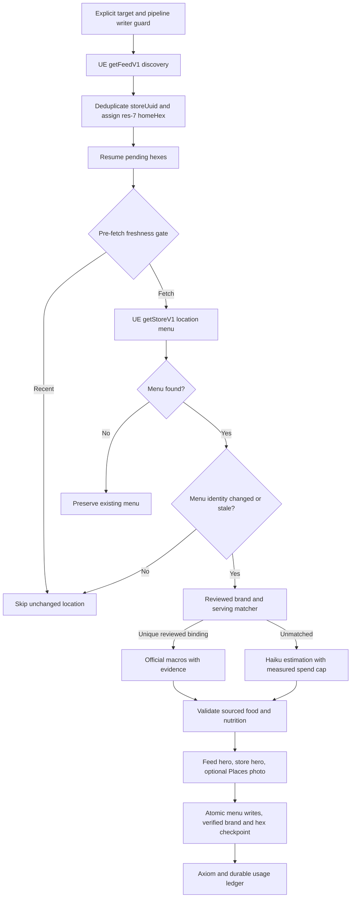

# UE-First Pipeline

**TL;DR:** UE supplies restaurant discovery and menu membership; reviewed official facts or estimates supply nutrition.

This is the current design for `scripts/preload-ue-first.ts`.
The [operational runbook](runbook.md) owns flags, DEV setup, accounting, resume and recovery.
[Pipeline v2](pipeline-v2-dev-poc.md) reuses the menu parser, matcher and atomic writer with Jev, a shared DEV queue and separate PDF workers.
The retired Overture/Brave/Firecrawl discovery design is retained in `../archive/data-pipeline-v3.md` as historical context.

## Execution boundary

Local commands target DEV or disposable loopback databases with explicit `PIPELINE_DATABASE_URL` credentials.
Production migrations belong to the existing [guarded Vercel Git main deploy](../devops/routine-production.md).
Production ingestion requires an approved cloud worker and a signed workload identity accepted by [the database guard](../devops/db-guardrails.md#script-mutation-boundary).
The current v2 workers refuse production even with production-write flags.
The [v2 cloud worker configuration](pipeline-v2-cloud-worker.md) is DEV-only pending deployment acceptance and separate production authorization.
Never run ingestion, catalog apply, refresh or rollback against production from a laptop.
No migration, catalog approval or data reset is authorized by this document.

## Flow

## Discovery and identity

`ueApiClient.ts` owns `getFeedV1`, pagination, `getStoreV1`, response parsing and bounded transport retries.
Discovery probes an H3 grid and deduplicates stores by `storeUuid`.
A location's response coordinates determine its resolution-7 `homeHex`.
Restaurant discovery provenance does not prove which provider supplied a historical menu.

`UeApiDirectSource` receives the known store UUID and fetches that location's menu directly.
Every restaurant uses this menu source, regardless of brand recognition or catalog coverage.
An explicitly empty UE menu skips the location without replacing its stored menu.
Unexpected transport errors or schema drift abort the hex rather than silently checkpointing incomplete data.

Source-qualified product IDs distinguish products with identical names and deduplicate repeated placements.
Menu hashes include serving context, source IDs and calorie labels.
See the [identity and cutover contract](../backend/idempotent-preload-spec.md) before refreshing existing data.

## Nutrition and persistence

`chainMenuResolver` resolves verified brand identity independently of macro provenance.
The reviewed catalog supplies nutrition only when the exact location menu item matches an approved serving.
The catalog never creates location menu membership.
Unmatched chain and independent items use the configured estimator.
The legacy command uses Haiku; v2 uses Jev and queues missing official source discovery for the separate PDF worker.

Existing historical estimates retain their source labels and compatibility priority in `macroProvenance.ts`.
Retiring a provider does not delete, relabel or re-estimate existing rows.
Ordinary refresh preserves existing chain flags; only the verified brand handoff establishes a new chain identity.

`validateItems` rejects non-food items and invalid nutrition before persistence.
`persistHex` commits menus, estimates, verified brand identity and the completion checkpoint in one transaction.
Missing estimates or a conflicting brand assignment roll back the hex.
The [reviewed serving contract](chain-serving-handoff.md) covers stale approvals, serving changes and nutrition-only updates.

## Freshness, spend and recovery

The pre-fetch gate skips recently scraped locations unless `--force` is set.
The post-fetch gate compares the menu identity hash and freshness threshold before estimation and writes.
The usage ledger records every billed Haiku attempt, including retries and rejected responses, before validation.
The observer reserves each full request envelope against the cumulative run cap before every chunk.
Active requests drain and remain charged when further paid work stops.
A failed or interrupted hex has no completion checkpoint and resumes with the same ledger and run ID.

Photo resolution uses the stored feed hero, the UE photo lookup, then optional Google Places search and photo requests.
Each Google request reserves its price bound against the shared daily Google budget and the cumulative run cap before transport.
The [service budgets and telemetry](pipeline-v2-budgets.md) record each search and photo attempt, including failed calls.
The successful `photoSource` distribution alone cannot measure paid call volume.

The legacy command uses process-local UE and estimator semaphores.
The v2 queue adds shared PostgreSQL UE throttling, leased jobs, paid-call replay and token-fenced atomic completion.
Do not run independent ingestion or refresh processes against the same locations concurrently.

## Historical baseline and proof

The June 12 Stage 3 baseline reported 94 restaurants, 6,791 items and zero Google Places calls for one LA hex.
That historical sample is not a current throughput, cost or nationwide coverage guarantee.
The previous v6 sample and comparison remain in `../archive/baseline-v6.md`.

`preload-cost-e2e.test.ts` drives the actual legacy CLI with only external database and provider boundaries simulated.
It requires UE-only menu requests, valid estimation accounting and an atomic completion checkpoint without extra provider credentials.
`pipeline-v2/cli.test.ts` drives the real v2 entrypoint through reviewed matches, unresolved servings, resume, failure and spend-cap recovery.
Real database serving and identity regressions replay captured UE menus through the actual matcher and writer in a disposable loopback database.
