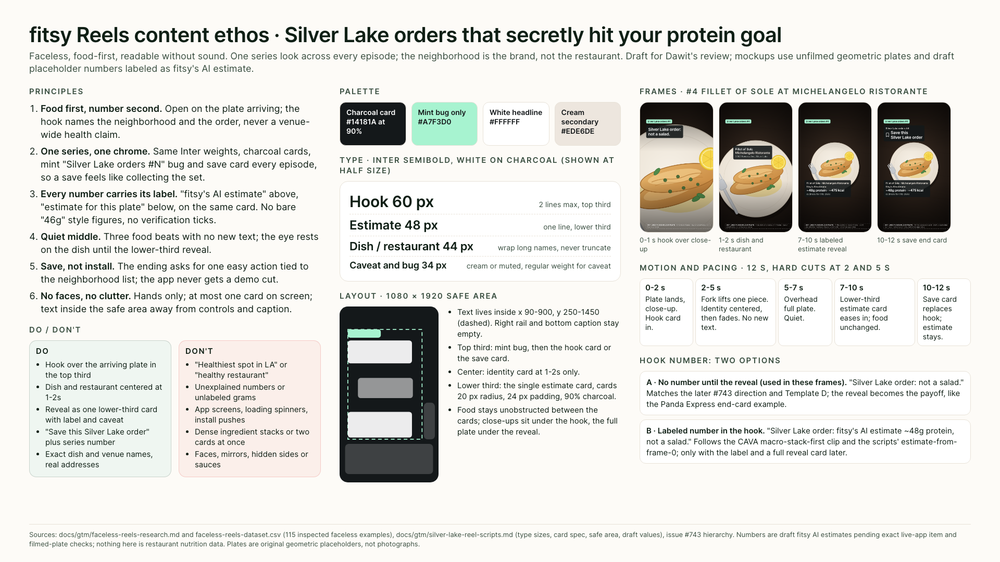
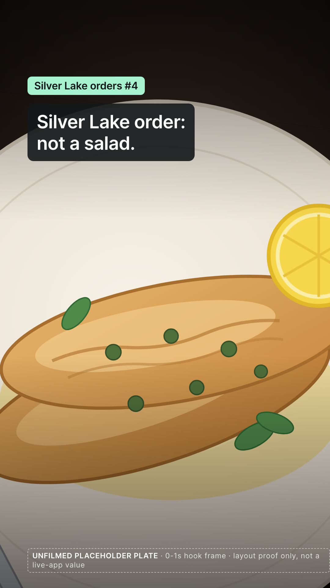
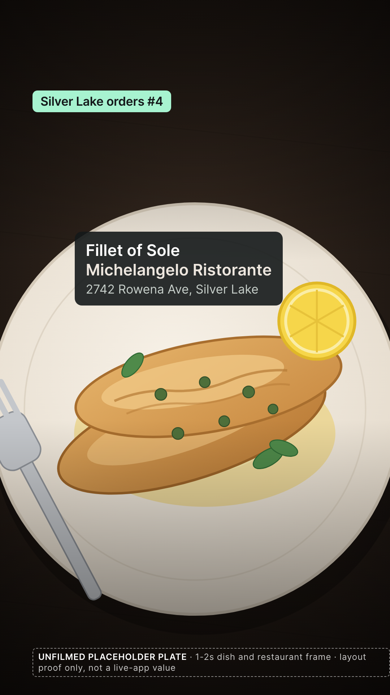
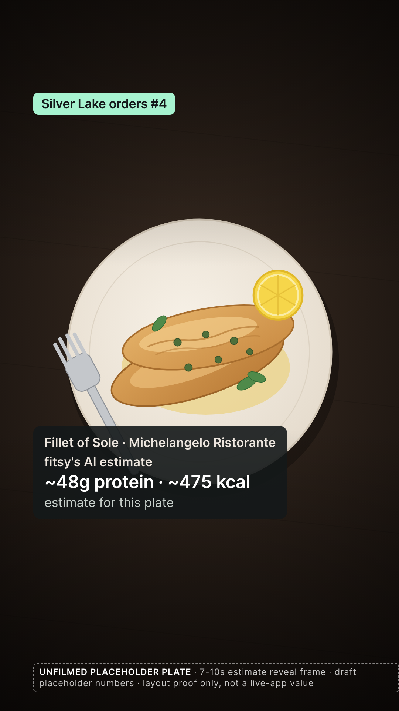
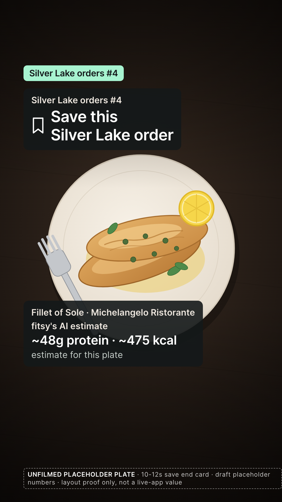

# fitsy Reels content design ethos: Silver Lake orders

**TL;DR:** One faceless, food-first series look, every number labeled as fitsy's AI estimate, and a save ending.

> **Status:** draft for Dawit's review, an alternative visual take to [PR #744](https://github.com/dgmolla/fitsy/pull/744) · **Last verified:** 2026-11-10 · **Owner:** Fitsy Marketing
> Nothing here authorizes publication, filming, outreach or spending.
> Every number is a draft placeholder from the [Silver Lake scripts](../silver-lake-reel-scripts.md), and every plate is an original unfilmed geometric placeholder.



## What this is

This is the content design ethos for the LA launch's organic Instagram Reels, following the visual strategy in [issue #743](https://github.com/dgmolla/fitsy/issues/743).
It turns the [faceless Reels research](../faceless-reels-research.md), its [115-example dataset](../faceless-reels-dataset.csv), the merged scripts and the [LA launch strategy](../la-launch-strategy.md) into one repeatable look.
The series is "Silver Lake orders that secretly hit your protein goal": the neighborhood is the brand, the restaurant changes each episode, and the chrome never does.
Mockups below use script #4, Fillet of Sole at Michelangelo Ristorante, 2742 Rowena Ave, because its draft value matches the issue's own 48g hook example.

## Principles and where they came from

1. **Food first, number second.**
   Open on the plate arriving, with the hook naming the neighborhood and the order, never a venue-wide health claim.
   Source: the CAVA how-to clip (research example 1, `tiktok-7584209134459964685`) puts the order benefit over live assembly before any brand line, while the Talo Organic Reel (`instagram-DNkBzWyuiYA`, "healthiest restaurant in Los Angeles?") and the Faregrounds Reel (`instagram-DKAHBRpJIVe`, "LA's healthiest breakfast burrito") show the venue-wide overclaim the research flags as a concrete risk.
2. **One series, one chrome.**
   Same Inter weights, charcoal cards, mint "Silver Lake orders #N" bug and save card every episode, so saving one feels like collecting the set.
   Source: the research's cross-post audit records Better Bowls numbering its TikToks "Episode 1" and "Episode 2", and the Carnivorous LA "Eagle Rock's Best NEW Hidden Gem" edit (`tiktok-7698459563955162381`) leads with the neighborhood rather than the venue name; the research notes its view ratio but cannot prove the hook caused it.
3. **Every number carries its label.**
   "fitsy's AI estimate" sits above the figure and "estimate for this plate" below it, on the same card, with no bare numbers and no verification ticks.
   Source: Chipotle's menu montage (research example 14, `tiktok-7586779412733988151`) loses the unit behind a bare "46g", Hummus Republic's "52G OF PROTEIN" opener (`tiktok-7693569934135381256`) presents an unverified brand number as fact, and the Luna Grill Reel (`instagram-DUcBeSdj6mB`) uses green check marks that read as verification.
4. **Quiet middle.**
   Three food beats carry no new text, so the eye rests on the dish until the lower-third reveal.
   Source: the two Subway POV clips (research examples 4 and 5) keep the order legible through the food alone, and Sweetgreen's lower-third protein strip (research example 10, `tiktok-7572235699710119182`) shows how one small, consistent card placement stays readable through hard cuts.
5. **Save, not install.**
   The ending asks for one easy action tied to the neighborhood list, and the app never gets a demo cut.
   Source: CAVA's "SAVE THIS ORDER" opener (research example 13, `tiktok-7644739997911797022`) and its "SCREENSHOT FOR YOUR NEXT MEAL" ending (research example 12, `tiktok-7598677513803533599`) give a concrete reason to retain the post; the research warns that the CAVA creator clip's app insert risks making the film feel like an ad.
6. **No faces, no clutter.**
   Hands only, at most one card on screen, text inside the safe area and away from the controls and caption.
   Source: the research counted only presenter-free footage and excluded every face-led lead, and the merged scripts fix the safe area and card spec used below.

## Palette

| Role | Value | Use |
| --- | --- | --- |
| Charcoal card | `#14181A` at 90% opacity | Every text card; 20 px radius, 24 px padding |
| Mint bug | `#A7F3D0` with charcoal lettering | The series bug only; never a tick, badge or number |
| White | `#FFFFFF` | Hook, dish name, estimate figure, save CTA |
| Cream | `#EDE6DE` | Restaurant name, estimate label, series line |
| Muted | `#C7CFCA` | Caveat text in regular weight |

The scripts specify charcoal and mint without hex codes; these values instantiate them and reuse the app's cream token (`bgElevated` in `apps/mobile/lib/theme.tsx`) so the series feels like fitsy without showing the app.
Even with the 90% card composited over the brightest plate tone, white text stays above 13:1 contrast and the muted caveat above 8:1, so every line reads without sound on a phone.

## Typography

Inter semibold throughout, from the merged scripts: 60 px hook, 48 px estimate figure, 44 px dish and restaurant, 34 px caveat, label and series bug.
Hooks wrap to at most two lines; long dish names wrap rather than truncate; the caveat is the only regular-weight line.
Keep the exact menu name and restaurant name as written in the ledger.

## Layout

- 1080 × 1920 master; all text inside x 90-900 and y 250-1450, away from the right-rail controls and the bottom caption.
- Top third: the mint bug at the safe-area corner, then the hook card (0-2 s) or the save card (10-12 s).
- Center: the identity card at 1-2 s only, placed above the fillet so it never covers the food detail.
- Lower third: the single estimate card with identity line, label, figure and caveat.
- The food is framed so it stays unobstructed between cards: a close-up under the hook, a smaller overhead full plate under the reveal and save cards.

## Motion and pacing

12 seconds, hard cuts at 2 and 5 seconds, matching the scripts.

| Time | Food | Text |
| --- | --- | --- |
| 0-2 s | Plate lands, close-up | Hook card eases in over the top third; bug persists |
| 2-5 s | Fork lifts one piece | Identity card centered, then fades; no other text |
| 5-7 s | Overhead full plate | Quiet |
| 7-10 s | Same full plate | Lower-third estimate card eases in; food unchanged, no app screen |
| 10-12 s | Same full plate | Save card replaces the hook; estimate stack and bug stay |

Cards fade and slide 12 px, never pop or bounce; no counters, spinners or loading animation.

## Hook number: two options

- **A, no number until the labeled reveal (used in these frames).** "Silver Lake order: not a salad."
  This follows the later #743 comments, the research's Template D and the Panda Express Short (research example 3), which promises the number up front and reveals it at the end.
- **B, labeled number in the hook.** "Silver Lake order: fitsy's AI estimate ~48g protein, not a salad."
  This follows the CAVA macro-stack-first clip (research example 12) and the scripts' estimate-from-frame-0 rule.
  It is acceptable only with the label in the hook and the full reveal card later, never as a bare figure.

Treat the choice as a hook test, with no winner assumed in advance.

## Do and don't

| Do | Don't |
| --- | --- |
| Hook over the arriving plate in the top third | "Healthiest spot in LA" or "healthy restaurant" |
| Dish and restaurant centered at 1-2 s | Unexplained numbers or unlabeled grams |
| One lower-third reveal card with label and caveat | App screens, loading spinners, install pushes |
| "Save this Silver Lake order" plus the series number | Dense ingredient stacks or two cards at once |
| Exact dish and venue names, real addresses | Faces, mirrors, hidden sides or sauces |

## Mockups: Silver Lake orders #4

Draft placeholder from the scripts: fitsy's AI estimate ~48g protein · ~475 kcal, exact app item and filmed serving unconfirmed.

| 0-1 s hook | 1-2 s dish and restaurant | 7-10 s estimate reveal | 10-12 s save end card |
| --- | --- | --- | --- |
|  |  |  |  |

## Limitations

- The plates are original geometric placeholders rendered in code; no food was filmed and no photo was used.
- The numbers are draft fitsy AI estimates from Dawit's November 5 snapshot via the scripts, not restaurant nutrition facts and not live-app-verified values.
- The frames prove layout, hierarchy and chrome only; performance, exact item match and portion remain untested.
- The research sample is 115 inspected examples, 35 short of its original target, and it cannot prove that any pattern causes results.

## Regenerate

```sh
python3 docs/gtm/claude-content-ethos/render.py
```

The script needs Python 3, Pillow and a local Chrome; it embeds Inter from the repo's installed dependencies when `node_modules` exists.
