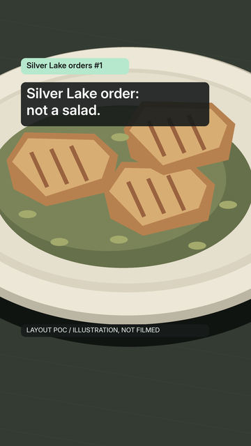
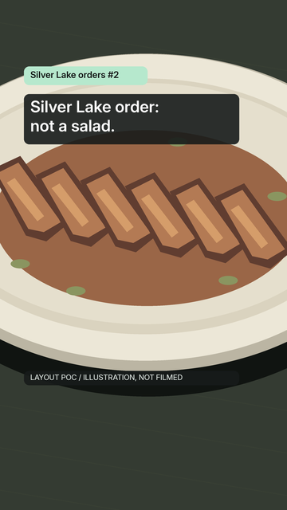
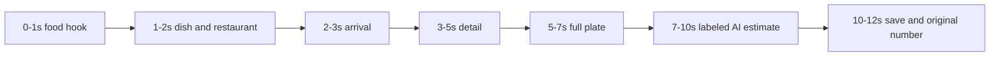

# Silver Lake orders: visual system POC

**TL;DR:** Two illustrated episodes demonstrate one food-first series for Dawit's draft review.

> **Status:** proposed, draft review only · **Last verified:** 2026-11-05 · **Owner:** Fitsy Marketing, sole #743 worker
> This POC proves layout and hierarchy, not actual food appearance, live-app confirmation, finished Reels or measured performance.
> Every macro is a draft placeholder; nothing is cleared for filming, publication or shipping.

## Review the frames

Start with the [side-by-side series comparison](pocs/silver-lake-reels/series-comparison.png).
Its two columns are the original episodes #1 and #2; each embedded phone is 360 × 640 at 100%.
The seven-frame storyboards show the whole proposed 12-second sequence.
The phone PNGs below are actual 9:16 previews, not screenshots of a design tool.

| Original script | Seven keyframes | Hook, 360 × 640 | Estimate, 360 × 640 | End, 360 × 640 |
| --- | --- | --- | --- | --- |
| #1: Pollo al Cilantro at Casita del Campo | [Storyboard](pocs/silver-lake-reels/sl-01-storyboard.png) | [Hook](pocs/silver-lake-reels/sl-01-01-hook-phone.png) | [Estimate](pocs/silver-lake-reels/sl-01-06-estimate-phone.png) | [End](pocs/silver-lake-reels/sl-01-07-end-phone.png) |
| #2: Grass-Fed Carne Asada at Mixto Comida Latina | [Storyboard](pocs/silver-lake-reels/sl-02-storyboard.png) | [Hook](pocs/silver-lake-reels/sl-02-01-hook-phone.png) | [Estimate](pocs/silver-lake-reels/sl-02-06-estimate-phone.png) | [End](pocs/silver-lake-reels/sl-02-07-end-phone.png) |

| #1 phone hook | #2 phone hook |
| --- | --- |
|  |  |

## One recognizable series

The concept remains the brief's Silver Lake food discovery series, with the repeatable audience identity **"Silver Lake orders #N"**.
The source's "secretly hit your protein goal" direction becomes curiosity about an order, never a promise that a dish fulfills an individual's goal.
Both selected venues have Silver Lake location evidence; no outside venue receives this neighborhood branding.
The same type, card geometry, mint bug, placement, illustration framing and save screen apply to both original script numbers.
Restaurant identity changes inside that system rather than replacing it.

The design source is [the merged #741 script document](https://github.com/dgmolla/fitsy/blob/3816a7d4fb2798420e24e14641e9a25146211e8d/docs/gtm/silver-lake-reel-scripts.md), pinned to source/base commit `3816a7d4fb2798420e24e14641e9a25146211e8d`.
The [#743 owner instruction](https://github.com/dgmolla/fitsy/issues/743#issuecomment-6668925987) supersedes its estimate-from-frame-0 and immediate-name timing.
Here the hook stands alone at 0-1s, identity arrives at 1-2s, three quiet food beats follow, and numbers first appear in the lower-third reveal at 7s.
The source's 12-second duration, exact identities, values, save wording and concrete visual dimensions remain.

## Type, cards and safe areas

Coordinates and type sizes refer to the 1080 × 1920 master, not device points.
All text, including artifact-only framing, stays within the source's x=90-900 and y=250-1450 safe rectangle.
That reserves 90 px left, 180 px right, 250 px top and 470 px bottom for platform chrome and captions.
It is the inherited design envelope, not a claim that current social interfaces were inspected.

| Element | Concrete specification | At 360 × 640 |
| --- | --- | --- |
| Family | Inter from the already installed Expo dev-menu font assets; semibold for audience headlines, identities, bug and estimates | Same rasterized family |
| Hook / save headline | 60 px, 73 px line advance; x=114, y=378 and 451, top third | 20 px type |
| Dish / restaurant | 44 px, 64 px line advance; x=114; centered introduction at y=784/848, then y=594/658 | 14.7 px type |
| AI estimate | 48 px, 60 px line advance; x=114, y=1184/1244 | 16 px type |
| Plate caveat | 34 px regular; x=114, y=1313 | 11.3 px type |
| Series bug | 34 px semibold; card x=90, y=250, w=465, h=70 | 11.3 px type |
| Charcoal cards | `#171B1A` at 90% opacity, 20 px radius, at least 24 px content padding | 6.7 px radius, 8 px padding |
| Mint bug | `#B6E8CD`, charcoal lettering; the only mint accent, no verification tick | Same color |
| Reveal card | x=90, y=1160, w=810, h=210; retained through the save frame | 270 × 70 px |
| Artifact-only strip | 28 px medium, y=1409: "LAYOUT POC / ILLUSTRATION, NOT FILMED" | 9.3 px, outside audience copy |

The source specifies charcoal and mint without hex codes; these hex choices instantiate those colors for this POC.
White `#FFFFFF` is primary; `#D7DEDA` is the restaurant/caveat color.
Even a white background composited under the 90% charcoal card yields 9.49:1 contrast for the muted caveat color; the mint/charcoal bug reaches 12.76:1.
Cards cover negative space or the plate rim; the full-plate food detail remains visible above the estimate.
The longest selected dish name fits in one 44 px line with padding; longer future identities must wrap across two lines and expand the identity card rather than shrink type.

The estimate appears as two consecutive lines, preserving the exact wording when read together: **"fitsy's AI estimate ~Xg protein · ~Y kcal"**.
The following line is exactly **"estimate for this plate"**.
Keep protein units, the approximation markers and the AI attribution together; no unlabeled number appears in the hook or food beats.
There is no install prompt, app demo, loading animation, confidence badge, faces or dense paragraph overlay.
The reveal adds a quiet piece of order context after food discovery; its unchanged plate background and modest lower-third card avoid an ad-like interruption.
This is a design rationale, not measured evidence of viewer response.

## Seven keyframes per episode

All master links below are 1080 × 1920 PNGs.
The three food beats demonstrate crop and hierarchy only; actual fork movement, texture, accompaniments and portions require owned or licensed footage later.
Identity remains visible after 1s; it moves above the food after the centered introduction and stays through the save screen.
The same full-plate composition is reused from beat 3 through reveal and end.

| Time | Frame purpose and conditional audience copy | Script #1 master | Script #2 master |
| --- | --- | --- | --- |
| 0-1s | Food close-up, top-third "Silver Lake order: not a salad."; persistent numbered mint bug | [Hook](pocs/silver-lake-reels/sl-01-01-hook.png) | [Hook](pocs/silver-lake-reels/sl-02-01-hook.png) |
| 1-2s | Centered exact dish and restaurant; hook clears | [Name](pocs/silver-lake-reels/sl-01-02-name.png) | [Name](pocs/silver-lake-reels/sl-02-02-name.png) |
| 2-3s | Food beat 1: arrival close-up; quiet retained identity | [Arrival](pocs/silver-lake-reels/sl-01-03-food-arrival.png) | [Arrival](pocs/silver-lake-reels/sl-02-03-food-arrival.png) |
| 3-5s | Food beat 2: tighter detail; eventual fork lift follows the source script | [Detail](pocs/silver-lake-reels/sl-01-04-food-detail.png) | [Detail](pocs/silver-lake-reels/sl-02-04-food-detail.png) |
| 5-7s | Food beat 3: full plate; actual separate components must be visible in future footage | [Full plate](pocs/silver-lake-reels/sl-01-05-food-full.png) | [Full plate](pocs/silver-lake-reels/sl-02-05-food-full.png) |
| 7-10s | Lower-third AI estimate and plate caveat, over unchanged full plate | [Estimate](pocs/silver-lake-reels/sl-01-06-estimate.png) | [Estimate](pocs/silver-lake-reels/sl-02-06-estimate.png) |
| 10-12s | "Save this Silver Lake order"; retain exact identity, estimate/caveat and original numbered bug | [End](pocs/silver-lake-reels/sl-01-07-end.png) | [End](pocs/silver-lake-reels/sl-02-07-end.png) |

## Production provenance and holds

These are production notes, separate from conditional audience overlays.
The artifact-only illustration strip is a review safeguard and is not proposed audience copy.
All illustrated shapes, colors and arrangements are original procedural geometry, not photographs, reconstructions of restaurant dishes or representations of ingredient, piece-count or portion facts.
No restaurant image or third-party food asset was used, and no image-generation service, purchase or installed design tool was needed.
The POC must not be exported or reused as filmed food.

| Original script | Exact identity | Exact sourced address and neighborhood basis | Conditional reveal, still a draft placeholder |
| --- | --- | --- | --- |
| #1 | Pollo al Cilantro at Casita del Campo | 1920 Hyperion Ave, Los Angeles, CA 90027; source ledger's [official location](https://www.casitadelcampo.net/location/casita-del-campo/) and [history](https://www.casitadelcampo.net/our-history/) place it in Silver Lake | "fitsy's AI estimate ~38g protein · ~438 kcal" / "estimate for this plate" |
| #2 | Grass-Fed Carne Asada at Mixto Comida Latina | 2827 Hyperion Ave, Silverlake, CA 90027; source ledger's [official location](https://www.mixtomixto.com/location/mixto/) states Silverlake; this is Mixto, not MIXT | "fitsy's AI estimate ~36g protein · ~308 kcal" / "estimate for this plate" |

Address evidence is inherited from the merged ledger's 2026-11-05 page inspections, not independently reopened here.
The numeric provenance is [Dawit's November 5 production snapshot on #740](https://github.com/dgmolla/fitsy/issues/740#issuecomment-6667790335), also retained in the merged source.
Its HIGH tier is model confidence, not verified merchant nutrition.
Portions are not stored; the figures establish neither a whole meal nor inclusion of sides, tortillas, rice, beans, sauce or other additions.
Neither exact current live-app item nor filmed plate has been confirmed for either selected episode.
Before a publishable numeric cut, match the current location, menu identity, app item/value and complete filmed serving, including every separate component, and record that match and date.
Hold the numeric cut if they cannot be reconciled.
Dawit's visual review does not itself establish that match, approve filming or authorize publication.
The #732 Instagram and TikTok viewing stops remain in force; this work used no social access.

## Render and visual QA

The task-owned reproducible source is retained at `.evidence/mkt-743/render_frames.py` in this worktree.
Run `python3 .evidence/mkt-743/render_frames.py` using the existing Pillow installation and installed Inter assets; no dependency was added.
Never touch up the PNGs manually: change that source, regenerate all views, then reinspect the changed final images.
The source, generation manifest, hashes and raw checks stay in this owner's ignored evidence for same-owner continuation after review.
Only the requested specification and static PNGs are tracked.

Rendered-image inspection used the available image viewer on all six 360 × 640 hook/estimate/end files at original size, both seven-frame storyboards, the final side-by-side, and full-resolution name/reveal frames.
The first pass moved the opening food crop upward so the hook sits over the close-up, then regenerated the final PNGs.
The final pass found no clipped or cramped identities, broken protein units, detached AI attribution, unreadable plate caveats, misaligned cards or inconsistent series chrome.
The full-plate identity card touches the rim rather than the food detail, with the estimate below the plate.
Automated render assertions check every text bound against x=90-900/y=250-1450 and inventory every PNG's dimensions and SHA-256.
There are 14 master frames, six 360 × 640 previews, two storyboards and one two-episode comparison: 23 PNGs total.

Local checks, hosted results and approval state belong in the draft PR and #743 handoff, so this specification does not freeze changing check status.
The authorized phase ends at a visually inspected draft PR for Dawit; issue #743 stays open and the same worker retains the source and next action.
After explicit approval, the orchestrator routes continuation to this owner for the approved next stage and any still-required exact-head review/checks.
