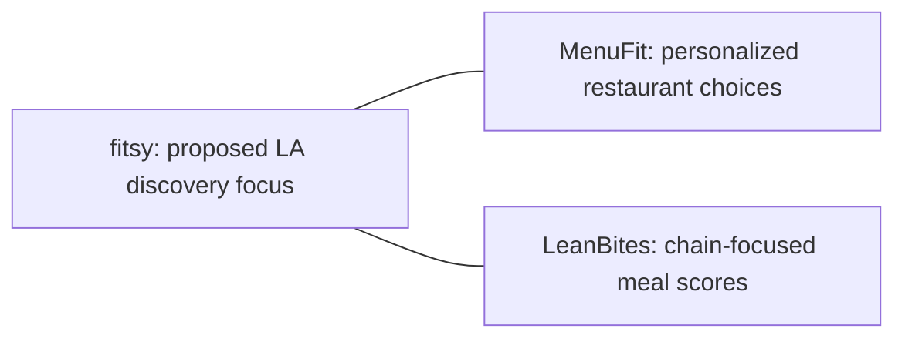

# Competitors

**TL;DR:** Differentiate through demonstrated LA usefulness; competitor breadth, accuracy and channel economics need qualified claims.

> **Status:** Living · **Last verified:** 2026-11-03
> Public-source review for [issue #720](https://github.com/dgmolla/fitsy/issues/720); no competitor app or private account was exercised.

| Product | Publicly supported observation | Limit |
| --- | --- | --- |
| MenuFit | [Official positioning](https://menufitapp.com/) includes local favorites as well as chains; its [App Store description](https://apps.apple.com/us/app/menufit-healthy-eating-out/id6746144481) includes menus without published macros. | Vendor coverage claims do not prove complete menus or accurate estimates at a given LA restaurant. |
| MenuFit creators | The [official offer](https://creators.menufitapp.com/) recruits videos for Meta ads, offers $20 for the first approved video and advertises 10% of ad spend; creator posting is optional. | Offer terms are not audited spend, payouts, profitability or a retained-user acquisition benchmark. |
| LeanBites | Its [own comparison](https://leanbites.app/blog/leanbites-vs-menufit-macros-eating-out) states a major-US-chain focus; its [homepage](https://leanbites.app/) promotes goal-based scores and delivery links. | This establishes marketing focus; it does not prove the complete inventory or working delivery integration. |
| Adjacent alternatives | [Healthy Anywhere](https://healthyanywhere.com/get-healthy-anywhere-app/) markets LA restaurant discovery; [DineSense](https://dinesense.app/) advertises dish selection and approximate nutrition. | Different product emphasis; current LA depth and traction were not verified. |

The earlier $300K MRR figure, retention inference from reviews, and broad claims about fabricated menus or fitsy's superior accuracy lacked a reproducible dated comparison and are not current evidence.
[Onbo Hub's MenuFit story](https://onbo-hub.com/apps/menufit/story) labels its newer revenue figure an external estimate and its funnel claims unverified.
Do not substitute either revenue number for audited performance.

The [launch review](../gtm/la-launch-strategy-review.md#what-the-research-changes) contains the channel distinctions, review limitations and unresolved LeanBites creator-program terms.
The [LA strategy](../gtm/la-launch-strategy.md) owns launch positioning and channel selection.
Before making a comparative superiority claim, compare the same real restaurants, dishes, servings and release versions and retain dated evidence.
