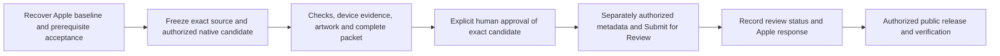

# Next Fitsy iOS submission - issue #444

**TL;DR:** Preparation is documented; Apple baseline, prerequisite acceptance, final binary, artwork, and human approval remain open.

Prepared on 2026-10-24 for [#444](https://github.com/dgmolla/fitsy/issues/444).
This is a local review packet, not approval to publish metadata, upload, submit for review, or release.
No EAS build/submit, Apple mutation, version edit, commit, or push was performed.
The existing Fitsy Delivery owner retains release execution; prerequisite owners retain their acceptance work.

## Baseline and candidate identity

**Confirmed** means inspected repository evidence or an identified historical receipt, not a fresh Apple read or device pass.
**Recommended** means a proposed edit awaiting evidence and human review.
**Unknown** means evidence is unavailable and must be supplied before the submission gate.

| Identity | Evidence and state |
| --- | --- |
| Actual last Apple submission | **Unknown:** submitted version/build, submission date/status, metadata/localizations, screenshots, reviewer information, declarations, product configuration at submission, and prior Apple feedback have not been retrieved |
| Last version-like Git tag | **Confirmed:** `v1.0.0` points to `4d6cc5d12824ad576eabf32ba753186f26f0ab15` (commit date 2026-08-26); its app config says version `1.0.0`, build `4`, bundle `com.fitsy.mobile`; a tag is not an Apple submission receipt |
| Other local tag | `e2e-sprint7` points to `c402df4db6c5b0c3d9c7626a7ce586fb34cd6e3b`; this is a test milestone, not submission evidence |
| Best verified native anchor | **Confirmed historical evidence:** processed version `1.0.0` / build `5`, source `2e515fdc339d27e33110e128379fb16bd3a2d3a5`, verified 2026-10-07; processing/eligibility does not prove App Review submission or public release |
| Anchor EAS / Apple build IDs | `3391d4bf-905e-4c78-8ae3-4f88f7cbf51b` / `cc103859-443d-43d9-a165-da04534c952b` |
| Anchor IPA SHA-256 | `e31663a3f57f715a357ffbd487f4d912fe46ed9b5ac82543d3a87724ed506c56` |
| Native identity | `com.fitsy.mobile`; ASC app `6763851364`; runtime `1.0.0`; channel `production`; EAS project `a204190c-0b71-4c31-b126-f3bc62d1c4ee` |
| Inspected source snapshot | `5f9831add945c26004442c678ac2a4917580c191`, tree `783f53e1ecf61bcc54b28e5dd6d457bc5e3bcecb`, branch `codex/issue-444`, equal to local `origin/main` when inspection began; remote freshness, CI, deployment, and device uptake were not established |
| Current version files | [app.config.ts](../../apps/mobile/app.config.ts): `1.0.0` / `5`, `runtimeVersion.policy = appVersion`, iPhone only; [eas.json](../../apps/mobile/eas.json): production channel and ASC app ID; no tracked `app.json` exists; workspace package version `0.1.0` is not the iOS marketing version |
| Proposed final source / binary | **Unknown:** no release freeze, new build ID, IPA hash, native fingerprint, embedded JS identity, or processed Apple build exists for this packet |
| Intervening OTA | **Unknown:** production update group(s), runtime, manifest/bundle hashes, rollout dates, rollback state, and actual device uptake must be read and compared with both the embedded build-5 bundle and the next binary |

Native-anchor evidence: [reviewed binary receipt](../../scripts/deploy/ios-binary-baseline.json), [OTA baseline and provenance](../engineering/devops/ios-ota-baseline.md), and [#243](https://github.com/dgmolla/fitsy/issues/243).
History inspected with `git tag`, `git log --all -- apps/mobile/app.config.ts apps/mobile/app.json apps/mobile/eas.json`, and `git show v1.0.0:apps/mobile/app.config.ts`.
The September 23 history explicitly describes “TestFlight build 5”; that also does not identify the last App Review submission.

### Apple account boundary and supported recovery

The coordinator's `work/app-store-baseline-read-blocker.json`, observed 2026-10-04T01:16:35Z, records a read-only `appStoreVersions`/builds request returning HTTP 403, `FORBIDDEN.REQUIRED_AGREEMENTS_MISSING_OR_EXPIRED`.
The retained October 5 recheck records the same refusal.
No version or submitted metadata was returned; the agreement type and terms remain unknown.
This preparation did not retry that unchanged account failure or accept any agreement.
The account owner must resolve the applicable agreement, then notify the existing release owner to resume read-only baseline retrieval.

Recovery assessment used the selected ship-branch and verify-fitsy skills, Git history, the baseline receipt, web tools, mobile inventory, and plugin-management discovery.
GitHub CLI issue reads failed with `error connecting to api.github.com`; public issue fetches also failed, so live issue acceptance, board state, and CI remain unverified.
Discovery found an unconnected GitHub plugin and no usable connected ASC/RevenueCat/EAS reader; no integration was installed and no credentials were requested.
Do not retry private APIs through another path to evade the agreement or workspace restrictions.
The updated [release runbook](../engineering/devops/ios-release-runbook.md) and [listing draft](../product/app-store-listing.md) route future preparation to this packet and keep this account recovery with the existing owner.
Global skills, account controls, and orchestration installation are outside this checkout's writable scope and were not modified.

On restored access, retain an export of the actual last submitted version/build, localized fields, screenshot assets/checksums, review contact/access instructions, declarations, release mode, IAP/subscription offers and prices, and all review messages.
Map it to EAS source/IPA/native/runtime evidence where available; leave unmapped fields unknown.
Then replace the provisional comparisons below with actual old Apple values and reconcile intervening OTA behavior before freezing the packet.

## Required release scope

The intended release includes #431, #433, #442, and #443.
Merged code alone does not establish delivered/accepted behavior.
Missing work stays in scope until verified delivery or an explicit human release-scope decision is recorded on #444.
This packet grants no additional prerequisite review budgets or trial-test authority.

| Prerequisite | Evidence at inspected snapshot | Required disposition before freeze |
| --- | --- | --- |
| [#431 - selected offers and reminders](https://github.com/dgmolla/fitsy/issues/431) | Source merged at `68fe8d89` via #455; historical catalog record reports two-week regular offers on October 1 | Retrieve delivery/acceptance receipts and the human-owned real eligible Apple trial result, including entitlement expiration/reminder outcome; no simulator or catalog check substitutes for that result |
| [#433 - post-fetch coachmarks](https://github.com/dgmolla/fitsy/issues/433) | Main contains tour readiness guards, but no matching accepted #433 delivery was established; retained branch has additional spotlight/layout work | Existing owner must integrate and prove accepted behavior on the final source, including delayed fetch and anchor geometry, or obtain a recorded human scope decision |
| [#442 - no-trial sign-in](https://github.com/dgmolla/fitsy/issues/442) | Earlier routing merged at `89c23ce6` via #454; current `wt-11-442/.evidence/issue-442/merge-handoff.json` explicitly records unfinished merge/native acceptance, not final delivery | Preserve that owner's work and genuine prior review/UI scope; complete integrated source, checks, provider sign-in and purchase recovery evidence, or record a human scope decision |
| [#443 - macro/calorie synchronization](https://github.com/dgmolla/fitsy/issues/443) | Source merged at `3039d69be02531d8fa4a34fea6a05069750c74f8` via #466, included in this checkout | Retrieve exact-source Verify/Deploy and applicable API/native acceptance; recheck interactions with #442 before declaring the release ready |

## Compact change and decision packet

All **old submitted Apple values remain unknown**.
The “comparison evidence” column identifies a repository draft or source comparison, never submitted Apple metadata.
The following are candidate changes since the verified build-5 source, pending actual Apple/OTA reconciliation.

| Area | Old submitted value/state -> proposed value/state | Reason and comparison evidence | Decision or missing proof |
| --- | --- | --- | --- |
| Release identity | Unknown -> **Recommended** `1.1.0`, build `6` only if the highest allocated/uploaded build is still `5` | Significant onboarding, billing, and target changes justify a minor version; Git tag has build 4 while config and processed anchor have build 5 | Read all EAS/ASC allocations first, choose a strictly increasing unused build above the observed maximum, and choose a marketing version newer than the actual submitted/released baseline |
| Bundle and runtime | Unknown -> preserve `com.fitsy.mobile` and production project/channel; proposed runtime `1.1.0` follows the proposed marketing version | Actual historical IPA and current config agree; March draft's `app.fitsy.mobile` is stale | Confirm current ASC app identity without renaming the established bundle; build a new binary only in a later authorized task and preserve native-compatibility gates |
| Onboarding and preview | Unknown -> goal-first flow, two approved approach/payoff screens, known or assisted targets, real three-pick preview, recoverable typed search | `0feb2d1b` simplifies payoff stories; [personalized onboarding](../../apps/mobile/docs/personalized-onboarding-release.md) and [guided preview](../../apps/mobile/docs/guided-onboarding-release.md) describe the connected flow; build-5 source already contains much of it | Refresh screenshots and notes from the final candidate; verify location denial/manual entry, unsupported area, empty results, retry, Back, and selected meal preservation |
| Post-fetch coachmarks | Unknown -> five tips after settled preview fetch, with correctly aligned highlights | [previewTourReady.ts](../../apps/mobile/lib/previewTourReady.ts), [usePreviewTour.ts](../../apps/mobile/lib/usePreviewTour.ts); #433 remains an acceptance prerequisite | Demonstrate slow fetch, empty results, missing anchors, scrolling/layout changes, Skip/Back, and no stale/repeated overlay on accepted source |
| Sign-in, payment, resubscribe | Unknown -> simplified hard paywall, authentication before anonymous no-trial checkout, and account-bound active/lapsed routing | `f326f373`, `e163cff9`, `89c23ce6` and unfinished #442 continuation; [purchase lifecycle](../../apps/mobile/lib/usePurchases.tsx) | Demonstrate Apple and Google sign-in, expiry, cancellation, restore, retry, logout/account switching, and return to the selected meal; no test fixture in production |
| Trial eligibility and prices | Unknown -> live selected-product terms, with a 14-day regular-plan catalog policy and paid terms for ineligible/unknown eligibility or discounted annual | [trialPresentation.ts](../../apps/mobile/lib/trialPresentation.ts), [purchaseTerms.ts](../../apps/mobile/lib/purchaseTerms.ts), [historical pricing record](../product/business-model.md#pricing-decision-record) | Re-read ASC/RevenueCat and real StoreKit terms by storefront and account; do not promise a trial solely from repository policy |
| Trial reminder and timeline | Unknown -> refreshed trial invitation/artwork, selected-plan charge timeline, and optional reminder roughly 48 hours before verified expiry, moved earlier for quiet hours | [trialPolicy.ts](../../packages/shared/src/contracts/trialPolicy.ts), [notificationPlan.ts](../../apps/mobile/lib/notificationPlan.ts); #431 changes selected-offer presentation and reminder policy | Prove actual trial, opt-in/denial, permission recovery, short/late trial, DST/quiet hours, renewal and scheduling failure; projected dates before purchase are not a scheduled notification |
| Automatic recommendations and editing | Unknown -> lower automatic protein allocation, linked calorie/gram editing, and retained manual targets | #443/#466; [shared defaults](../../packages/shared/src/utils/macroTargets.ts), [macroEnergy.ts](../../apps/mobile/lib/macroEnergy.ts), [target conversion](../../apps/mobile/lib/macroCalculator.ts) | Verify edits in setup, profile and discovery, daily/per-meal conversion, incomplete input, offline retry, relaunch and account recovery; describe general planning defaults without clinical or outcome claims |
| Privacy | Unknown -> disclose account-linked profile/target sync and actual SDK data handling | March draft claimed targets stay only on-device, but [profileSync.ts](../../apps/mobile/lib/profileSync.ts) PATCHes `/api/user/profile` and [profileTargetBody.ts](../../apps/mobile/lib/profileTargetBody.ts) includes body facts and daily targets | Review Apple data types/purposes/linkage for health/fitness, identifiers, contact info, location, purchases and usage; inspect SDK manifests, retention/deletion and consent before approving answers |
| URLs and reviewer access | Unknown -> propose `https://fitsy.org/privacy`, `/support`, `/terms`, and a tested reviewer path | Current code has those legal routes and allowlisted `appreview@fitsy.org` via `fitsy://auth/reviewer`; the draft's `review@fitsy.app` subscription was never proven | Confirm URLs and inbox delivery, real production login/API access and written instructions; do not create an active-subscription claim from the allowlist |
| Nutrition, coverage and claims | Unknown -> distinguish estimates from reviewed official nutrition and support manual area selection | March draft equated high confidence with verification and required GPS; current source retains estimates plus reviewed facts and manual-location behavior | Remove those misleading claims; verify provenance/ranges on the final screen and avoid fixed coverage counts, “full menu for every restaurant,” or guaranteed fitness results |

At 2,000 daily calories, #443's automatic protein fractions are 15% muscle, 14% fat loss, 13% performance, and 12% maintenance, replacing the build-5 source's higher defaults.
Daily targets are allocated across 3.5 meal portions; settled calories use `4 × protein + 4 × carbs + 9 × fat`, so whole-gram rounding can adjust the displayed total.
Calorie edits rescale a complete allocation; gram edits recalculate energy; partial discovery filters remain independent constraints.
These are source-confirmed product defaults and editing rules, not a personalized clinical prescription or proof of health benefit.

### Store terms and submission answers

The October 1 repository record reports US monthly `$7.99`, annual `$39.99`, and discounted annual `$29.99`, with two-week eligible offers in 175 territories for the regular products and no introductory offer for the discounted product.
These are historical catalog observations, not freshly verified prices, universal availability, an eligibility verdict, or the terms in the last Apple submission.
Product IDs are `com.fitsy.mobile.monthly`, `com.fitsy.mobile.yearly`, and `com.fitsy.mobile.yearly_discount`; the RevenueCat entitlement is `pro`.
Capture live localized price, billing period, introductory duration, eligibility and renewal disclosure for each tested plan before approval.

| Submission answer | Proposed disposition and evidence still needed |
| --- | --- |
| Release mode | **Recommended:** manual release after Apple acceptance; human must explicitly approve the mode and any later public-release authorization, storefront availability, pricing or phased-release choice |
| Encryption | Current config declares `ITSAppUsesNonExemptEncryption: false`; confirm final binary/SDKs use only exempt encryption before retaining the declaration, and let the authorized owner handle any required documentation |
| Privacy / tracking / IDFA | Do not copy blanket “No” answers from the draft; audit [analytics](../../apps/mobile/lib/analytics.ts), account sync, RevenueCat, Supabase, location and notification practices, including third-party SDK manifests and required-reason APIs |
| Privacy policy accuracy | Source policy calls analytics anonymized/aggregated, while `identifyUser` accepts account ID, email, goal/activity and macro properties; reconcile actual callers, consent and partner handling before signing privacy answers |
| Content rights and age rating | Confirm rights for restaurant/menu imagery, names and feedback content; complete Apple's current questionnaire rather than copying the draft's “no third-party content” or `4+` |
| Reviewer information | Real contact name, phone, monitored email, working credentials and access instructions remain unknown; deliver credentials privately to ASC only after authorization, never in Git/chat |
| Account deletion / subscriptions | Verify Profile -> Delete account, reauthentication/error recovery, server/local pending-data deletion, and cancellation guidance; deleting a Fitsy account must not be described as canceling Apple billing |
| Prior review issues / agreements | Obtain actual Apple messages and demonstrate each remedy; agreement type, legal terms, trader/account declarations and any consequential choices belong to the account owner |

## Proposed App Store copy

This copy is **Recommended**, subject to baseline reconciliation, accepted scope and exact-candidate evidence.
It contains no fixed trial or price promise.
The proposed name is `Fitsy`, subtitle `Meals that fit your macros`, and keywords `macros,protein,restaurants,nutrition,meal planning,calories`.
Confirm localization, category, copyright and content rights against ASC before approving edits.

**What's New draft**

- Set meal targets with linked calorie and macro editing, with updated automatic recommendations.
- Find meals through a guided restaurant preview and keep your targets through search and account recovery.
- See subscription terms for your selected plan, with optional reminders for eligible trials.
- Improved sign-in, subscription recovery and restaurant-preview guidance, subject to #442 and #433 acceptance.

Remove the final bullet's internal acceptance qualifier only after those prerequisites are verified or replace the copy with the human-approved scope.
Remove anything already present in the actual last submission once its baseline is recovered.

**Description draft**

> Find restaurant meals that fit your protein, carb, fat and calorie targets.
> Choose a goal, enter targets you already know, or use Fitsy's general planning recommendations.
> Explore nearby meal picks and adjust your area manually when you prefer.
> Edit calories and macros together, compare dishes, and save favorites with full subscription access.
> Nutrition values include estimates and reviewed nutrition sources where available; they are approximate planning information, not medical advice.
> Subscriptions renew automatically unless canceled through your Apple subscription settings.
> Prices, billing periods and any eligible introductory offer appear before purchase.
> Privacy: https://fitsy.org/privacy
> Terms: https://fitsy.org/terms

Production URL reachability is not established by this draft.
Web retrieval returned content for [Terms](https://fitsy.org/terms), but returned cache-miss errors for Privacy and Support; those errors do not prove a production outage.
Terms still says both plans include a free trial, and source Support still assumes required location, verified high confidence and TestFlight beta access.
Source Privacy's analytics language also requires reconciliation as noted above.
Correct and verify applicable legal/support content through its existing owner before approval; this documentation task does not publish those pages or silently change legal terms.
Do not change `@fitsy.app` email addresses to `@fitsy.org` merely because the website moved; verify each monitored inbox first.

## Reviewer instructions draft

These instructions require an exact-binary walkthrough and working account before they can be approved or pasted into ASC.

1. Fitsy finds meals matching user-selected targets; launch into onboarding, choose a goal, and either enter known targets or use assisted setup.
2. Allow location or use manual area entry; verify the current covered test area, provisionally Silver Lake / Los Angeles `90029`, then wait for the restaurant fetch and inspect the five preview tips.
3. Preview access is bounded; opening full menus, saving or continuing beyond the preview leads to account/subscription access as applicable.
4. To review full access, open `fitsy://auth/reviewer` and sign in with the privately supplied allowlisted account; `appreview@fitsy.org` is a source allowlist, not proof that an account/password or server access works.
5. To inspect actual billing, use a separate appropriate Apple test account: eligible regular plans show their live introductory terms; ineligible/unknown offers and discounted annual show paid terms without a free-trial guarantee.
6. Exercise purchase cancellation, restore and resubscribe; opt in or decline optional reminders and compare projected dates with the actual post-purchase entitlement expiry.
7. Edit calories and macros in setup/profile/discovery, relaunch to confirm persistence, and verify Profile -> Delete account and Apple subscription-management guidance using a disposable account.

Disclose the reviewer access mechanism accurately; it is an allowlisted full-access path, not a preloaded paid subscription or evidence of a real Apple purchase.
Include contact details, precise coverage, any feature limitations and fixes for prior Apple feedback once verified.

## Artwork and device evidence

**Unknown/not produced:** no refreshed App Store screenshots or final-candidate device receipt were captured in this preparation.
The only available mobile device was the simulator named `Fitsy-442-c7913e95-iPhone-15`, owned by #442; it was inventoried without launching, resetting or using it.
Prior development screenshots and Test Store results cannot be relabeled as this release's production-binary evidence.

Apple's current [screenshot specifications](https://developer.apple.com/help/app-store-connect/reference/app-information/screenshot-specifications/) require a Dynamic Island medium-display iPhone screenshot, accepting portrait `1179 × 2556` or `1206 × 2622`.
Prepare a consistent `1179 × 2556` set, opaque PNG/JPEG, 1-10 images per size; the proposed set below has five images.
The current page also retains a large-display fallback requirement; confirm the actual ASC media slots and supply `1290 × 2796` only if that additional slot is required, rather than relying on the old draft's device matrix.
No iPad artwork is planned because the app config does not support tablets; confirm the final binary agrees.
Recheck the official page and ASC slots at capture time.

| Proposed image | State and truthful caption | Acceptance |
| --- | --- | --- |
| `01-targets.png` | Current goal/known-target setup: “Targets that fit your day” | Show real complete values and coherent calorie/gram totals; no retired preset-only onboarding |
| `02-preview.png` | Settled real restaurant preview: “Find meals that fit your targets” | Correct restaurant and meal data, no loading overlay or invented coverage count |
| `03-guidance.png` | Accepted post-fetch coachmark: “A little guidance to get started” | Correct spotlight geometry after fetch/scroll, no clipped controls |
| `04-nutrition.png` | Candidate meal detail: “Understand the nutrition behind each pick” | Actual source/confidence/range labeling; never equate high confidence with verified facts |
| `05-editing.png` | Linked target editor: “Adjust calories and macros together” | Demonstrate settled edits without fabricated health outcomes |

Keep extra reviewer evidence for onboarding/recovery, sign-in/payment/resubscribe, both offer-eligibility states, trial reminder/timeline and target editing; these are journey captures, not another hardware matrix.
For each capture retain source, binary ID/hash, runtime/update identity, backend, billing environment, dimensions, checksum and visual sign-off.
Inspect text contrast, clipping, spacing, cutouts and safe areas at full resolution; redact personal data without inventing app behavior.

## Shipping checks and human checklist

Use [shipping.md](../engineering/devops/shipping.md), the [iOS release runbook](../engineering/devops/ios-release-runbook.md), and existing source-bound product-flow tooling.
Apple currently requires uploads built with Xcode 26 or later and the iOS 26 SDK or later, effective April 28, 2026; verify the eventual native build image/logs against [Apple's SDK requirement](https://developer.apple.com/news/?id=ueeok6yw).
Review account access, accurate metadata, functional purchases and URLs against [App Review Guidelines](https://developer.apple.com/app-store/review/guidelines/), SDK/data declarations against [App Privacy Details](https://developer.apple.com/app-store/app-privacy-details/), and the current age-rating questionnaire before signing answers.
Local document/harness tests below are preparation validation, not release acceptance.

- [ ] Account owner resolves the applicable agreement; release owner retrieves and preserves the actual last-submission baseline and Apple feedback.
- [ ] #431 human trial result and #433/#442/#443 verified delivery/acceptance are attached, or the human records an explicit scope decision for each unresolved prerequisite.
- [ ] Compare actual last Apple submission, current served main/backend, intervening OTA and the intended embedded binary; finalize the change table and remove duplicate/stale release claims.
- [ ] Approve the version/build proposal after reading current allocations; preserve bundle/project identity and choose the production environment/channel without Test Store, dev auth, fixture, demo backend or keyless fallbacks.
- [ ] Freeze an exact source commit/tree, native inputs, dependency lockfile, public configuration identities and release scope; obtain matching required independent review, cheap/focused checks and trusted exact-source CI.
- [ ] In a separately authorized build task, create and process the production binary, recording EAS/ASC IDs, IPA SHA-256, embedded bundle/runtime, backend/RevenueCat configuration and toolchain; do not run builds/uploads under this preparation instruction.
- [ ] Complete source-bound API/native/device journeys and the #431 human Apple billing test; distinguish Test Store, Apple sandbox and actual production-store observations.
- [ ] Refresh and visually approve artwork at the current required dimensions; attach an asset manifest and exact-candidate walkthrough evidence.
- [ ] Verify legal/support URLs, monitored inboxes, reviewer credentials/full access, deletion and restoration; reconcile policy/SDK/privacy answers, content rights, age rating and prior review feedback.
- [ ] Choose release mode and all consequential account/declaration answers; legal agreements remain the human/account owner's responsibility.
- [ ] Present one complete packet identifying exact source/build/hash, metadata/assets, reviewer instructions and answers; request explicit human approval before any metadata publication or Submit for Review.
- [ ] If source, binary or consequential answers change after approval, reconcile approval with the human before submitting a materially different candidate.

No approval is requested now: the exact binary and required evidence are not yet available.
After later approval, the existing owner records separate receipts for upload, processing, submission, Apple acceptance/rejection and public release, following [Apple's submission steps](https://developer.apple.com/help/app-store-connect/manage-submissions-to-app-review/submit-an-app/) and [release-mode controls](https://developer.apple.com/help/app-store-connect/manage-your-apps-availability/select-an-app-store-version-release-option/).
An upload or processed build is never reported as Apple acceptance or a public release.

## Preparation validation

| Check | Local result |
| --- | --- |
| Canonical reproduction before repair | `node scripts/verify/run.mjs --only=structural --stage=cheap --scope=changed` failed only on the requested `docs/release/` domain; retained in `.evidence/verify/issue-444-structural-before.log` |
| Focused regression suite | `node scripts/verify/focused-tests.mjs --set scripts/verify/structural.test.ts`, then `node scripts/verify/focused-tests.mjs`: 1 suite / 6 tests passed, including accepted release docs, rejected unrelated domains/root files, and preserved subscription guards |
| Canonical static checks | `node scripts/verify/run.mjs --only=structural,context-freshness,secrets,migration-safety --stage=cheap --scope=changed`: 3 passed, 0 failed, migration-safety skipped because no migrations changed |
| Shell and patch validation | `bash -n scripts/structural-tests.sh` and `git diff --check` passed |
| Local links and draft field lengths | 37 packet/listing/runbook links and anchors resolved; proposed name/subtitle/keywords are 5/26/59 characters within 30/30/100 limits |
| Current patch's product-flow plan | `node scripts/verify/product-flow.mjs --plan` returned `required: false`, no affected product categories, for these documentation/structural changes; this does not waive the native release journeys above |

The registry, runner, hooks, workflows, package scripts, documentation, AGENTS.md and available skill references were inspected for connected callers.
The existing structural wrapper and canonical runner consume the revised domain rule; the regression suite exercised that actual path without changing workflow or approval semantics.
The checkout had no installed dependencies, so tests used an ignored task-local `node_modules` symlink to the retained #442 dependency installation after confirming package/lockfile equality against its recorded source `4eb1f0d263379fe10e46f3eac267873e4d549db1`.
No dependency source outside this checkout was modified and no installation/network retry was needed.
No pre-existing test failure appeared in the selected checks; the initial domain failure was reproduced and repaired.
Account access, live GitHub acceptance, stale legal/support claims, and missing final binary/artwork/device/billing proof remain the documented pre-existing release concerns.
Changes remain uncommitted and unpushed under the preparation instruction.
No current-candidate native, real purchase, production smoke, remote CI or App Review result is claimed.
