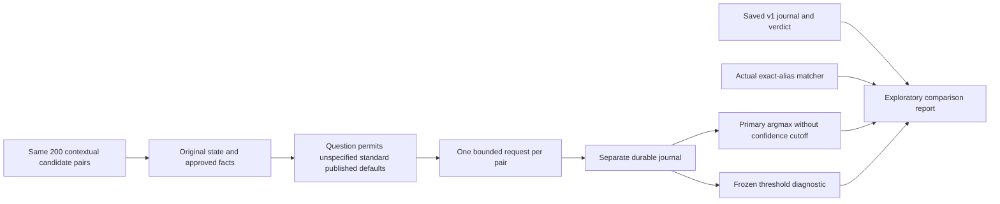

**TL;DR:** `--protocol=defaults` explores published serving defaults on the frozen 200 pairs without replacing the v1 verdict.

# Exploratory chain matching with published defaults

The ordinary `npm run eval:chain-match` command retains frozen v1 behavior unless `--protocol=defaults` is explicitly supplied.
`--protocol=v1` also selects the original behavior.
The benchmark, labels, thresholds, original question, saved journal and historical NO-GO verdict remain unchanged.



The question permits the chain's standard published serving and configuration when menu text does not specify them.
It still rejects a different protein, sauce, size, portion, dish, recipe or explicit configuration, unresolved alternatives and mixed proteins.
No aliases, rationale, labels, baseline results or additional default evidence are supplied to Jev.
The primary decoder accepts the highest-probability choice without a confidence cutoff, using the provider's choice for ties.
The response must still contain a valid confidence and complete probability distribution.
Both the exploratory responses and the saved v1 responses are also scored with the frozen v1 thresholds or argmax as explicitly labeled diagnostics.
The saved v1 journal and summary are hash-pinned and cross-checked before collection, preserving their original verdict.

The exploratory run has its own fresh output directory and `jev-raw.jsonl`, with at most 200 requests and a $0.50 local cap.
It reserves 16,384 input tokens per attempt, allows at most 12,000 UTF-8 request bytes, uses 5-second timeouts, and never retries.
It requests `jev-latest` and stops immediately if any response, including the first, resolves to a model other than `jev-1.14.0`.
Unknown usage, invalid responses, transport failures and envelope violations also stop collection.
Requests and responses are fsynced before sending and parsing; echoed credentials are redacted and stop the run.
Keys come only from the process environment during explicit live execution; replay requires no key, network, database or environment files.
The shared cost log is not modified.

`report.md` and `summary.json` compare defaults argmax, defaults under frozen probability/confidence cutoffs, saved Jev v1 under both decoders, and the real exact-alias baseline.
They retain confusion counts, accuracy, recall, false-positive and false-discovery rates, cost per 1,000 pairs, latency, model identity, stop conditions and full failure denominators.
The report prints all frozen thresholds, including match probability >=0.95, no-match probability <=0.05 and confidence >=0.90.
Numerical screening of the exploratory results is labeled diagnostic and cannot replace the frozen NO-GO verdict.
Missing or failed pairs count as incorrect over all 200 labels, and unknown usage never becomes free cost.
Partial reports exit nonzero through the real CLI.

This exploratory protocol snapshots the fixture, selection, question and collection policy in its journal without requiring a new commit.
The original v1 committed-benchmark guard remains in force.
No live compatibility, accuracy or production adoption claim follows from the offline simulated tests.

```sh
# Future collection only; use a fresh directory and an already configured process key.
npm run eval:chain-match -- --mode=live --protocol=defaults --out=/tmp/jev-chain-defaults

# Entirely offline; replay never resumes collection.
npm run eval:chain-match -- --mode=replay --protocol=defaults --journal=/tmp/jev-chain-defaults/jev-raw.jsonl --out=/tmp/jev-chain-defaults-replay

# Local validation; all provider responses are simulated.
npm run lint -w scripts
npm run type-check -w scripts
npm test -w scripts -- --runInBand --testPathPattern='eval/(jev-macro|chain-match|lib/(metrics|jev-experiment))'
```
