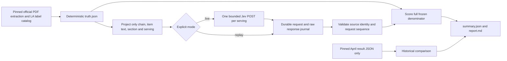
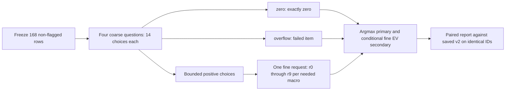

# Offline Jev macro accuracy eval

**TL;DR:** This scripts-only evaluator freezes 190 official servings and supports explicit live collection or entirely offline replay.

Nothing calls Jev by default.
Implementation and validation use only local fixtures and simulated provider responses.
No database, production service, credential file, environment file, historic model adapter or Anthropic client is imported or executed.



## Ground truth

`truth.json` is generated by `build-truth.ts`; regenerate it through the command below.
The deterministic selection includes every accepted direct row in the audited WaBa Grill and Yoshinoya PDF extraction (181), plus nine independently transcribed manufacturer labels bound to captured LA menus.
There are 88 WaBa Grill rows and 102 Yoshinoya rows.
Each chain and canonical published serving appears once in ASCII ID order.
Where independently reviewed LA menu bindings exist, choose the longest description, breaking ties by ASCII ordering of name, section and description.
Other rows use the published PDF name and section.
Serving text retains the catalog serving plus published mass when available.
Normalize the catalog's ambiguous `198 g protein side`/`166 g protein side` wording to `198 g side`/`166 g side`, retaining the published mass and no-rice context.
Remove complete marketing sentences containing nutrition quantities from descriptions, including both Poppi aliases' sugar/calorie claims.
The original descriptions remain in the pinned source catalog; no target quantity is moved into another prompt field.
Use original PDF decimals, rather than the catalog's rounded whole kilocalories.
The independently transcribed `chainBatchTruth`, `chainBindingTruth`, and `chainQualityTruth` provide additional checks where available; they do not supply estimated nutrition.

Every consumed source file is SHA-256 pinned, including extraction, catalogs, LA observations, independent bindings, April archives and the local pricing/metric definitions.
Each row also retains the published-source hash, URL, locator and repository audit identity.
PDFs and manufacturer pages are not downloaded or reverified remotely.
The confidence classification follows the repository's existing official-source audits, which are agent-reviewed rather than a new human precision review.

Exclusions are recorded individually in `truth.json` (17 entries).
They include 16 held PDF rows with inconsistent source facts: disputed shrimp, K-ribs, dumpling quantities, family salad, one combo protein, ambiguous kids' meals, gyoza and sweet-and-sour sauce.
The extra two-cookie fact is excluded because it is derived by multiplication; the direct one-cookie serving remains.
Duplicate LA contextual aliases, the duplicate default Chicken Bowl change, unresolved serving configurations, pipeline estimates, FatSecret data and older fastfoodnutrition.org eval truth are excluded.
The nine manufacturer label servings are included at their printed bottle/can sizes without inferred rescaling.
Historical archives are read only for comparison and never enter the new truth set or model input.

```sh
npm run eval:jev-macro:truth -w scripts -- --check
# Regenerate only after reviewing a source change:
npm run eval:jev-macro:truth -w scripts
```

## Collection and replay

Replay is the default mode and requires an existing raw journal.
`--out` must name a new directory whose parent already exists; even an empty existing directory is refused.
Live collection requires explicit `--mode=live` and reads the key only from `process.env.TYPESAFE_API_KEY`.
No dotenv loader or key-file fallback exists.
The endpoint, model, Bearer authentication, five-second timeout, redirect refusal and reported usage conventions mirror `apps/api/services/jevDecisionService.ts`.

## Choice-bin protocol v2

The [System One API](https://docs.typesafe.ai/api/system-one) supports `noul`, `choice`, `score` (at most 10 levels), and `box` questions, with no `number` question type.
Protocol v2 asks four `choice` questions, each with a `criteria` object containing 101 named choices, within the API's 1-255 choice limit.

| Question | Bounded bins, lower inclusive and upper exclusive | Open top bin | Open top representative |
| --- | --- | --- | --- |
| Calories | 25 kcal from 0 to 2500: `kcal_0_25`, ..., `kcal_2475_2500` | `kcal_2500_plus`: 2500+ kcal | 2525 kcal |
| Protein, carbs, fat (separate questions) | 2 g from 0 to 200: `g_0_2`, ..., `g_198_200` | `g_200_plus`: 200+ g | 202 g |

Each bounded bin uses its midpoint; the open top bin uses its lower edge plus 25 kcal or 2 g.
The estimate for each macro is `sum(probability * bin representative) / sum(probability)` across all 101 bins.
The decoded `estimate` and the highest-probability label in `argmaxBins` are recorded separately for each result in `summary.json`.
If bins tie for highest probability, the provider's `choice` breaks the tie.
Failed results have null estimates and null `argmaxBins`.

Validate `answers.<macro>.{type: "choice", choice, confidence, probabilities}`, a returned Jev model and integer input/output usage.
Every named bin must have a finite probability from 0 to 1, with no missing or additional bins; confidence must also be finite and from 0 to 1.
The selected choice must name a highest-probability bin, and probabilities must sum to one within 0.01 to allow rounding.
Normalize accepted rounded sums before averaging; never substitute confidence or the argmax midpoint for the full distribution.
The raw response journal retains the provider's original confidence and all probabilities.
Compact gram labels preserve the existing 12,000-byte request envelope for all frozen servings.
The choice contract is covered by simulated responses; this offline correction makes no new live compatibility claim.

Binning adds up to +/-half a bin of quantization error: +/-12.5 kcal or +/-1 g when the correct bounded bin is identified.
Wrong bins and distribution uncertainty can add further error, and the unbounded 2500+/200+ bins have no finite quantization-error bound.
Their fixed representatives compress the high tail rather than estimating how far beyond the threshold a serving falls.
The first-bin midpoints are 12.5 kcal and 1 g, so exact zero cannot be predicted; positive estimates against zero truth retain the April metric's 100% error.
These caveats also appear in generated reports and limit comparison with continuous historical estimates.

The first live attempt on 2026-10-26 used protocol v1's unsupported `number` questions and received HTTP 400 on its first request.
Its unchanged journal is retained as [failure evidence](results/2026-10-26-attempt1-400.jsonl), including the original protocol, request, raw error and unknown-usage stop without retry.
Protocol v2 has a new digest and rejects that v1 journal for replay; do not relabel or rewrite the historical evidence.

## Execution safeguards

```sh
# Offline: no key, network, database or model required.
npm run eval:jev-macro -w scripts -- --mode=replay --journal=/path/to/jev-raw.jsonl --out=/tmp/jev-macro-replay

# Future explicitly authorized collection only; key must already be in the environment.
npm run eval:jev-macro -w scripts -- --mode=live --out=/tmp/jev-macro-live
```

There is one POST per attempted serving, no retries, no batching and no truth nutrition or provenance in requests.
The state contains only chain, item name, description (including section) and serving.
Static questions specify the requested units without supplying targets.
Preflight rejects nutrition quantities embedded in item text so a future label-enriched description cannot leak targets.
Requests are fsynced before sending and raw response bodies are fsynced before parsing.
Output files are private, and authorization headers and exception text are never journaled.
If a provider echoes the key, redact that exceptional body, mark the event and stop.

The local spend cap is $1.00 at the frozen $0.042/M input price and free output, as recorded in `docs/engineering/pipeline/jev-chain-match-eval.md` on 2026-10-24.
Before each request, reserve 16,384 input tokens for a request bounded to 12,000 UTF-8 bytes, following the existing chain-match evaluator's conservative envelope.
All 190 requests at that envelope cost at most $0.13074432.
Account actual spend from reported usage, including billed invalid/HTTP responses.
Stop immediately on unknown usage, transport failure, reported input above the envelope, cap exhaustion or model-version drift.
The local cap assumes the provider bills within that bounded input envelope; a provider-reported violation is retained honestly and cannot be retroactively prevented by a client using post-response usage.
No run rewrites or appends to the existing shared cost journal.

Replay checks the frozen truth/protocol digests, every projected request, ordering, uniqueness and stop conditions.
It preserves the original journal bytes, counts unfinished requests as unknown usage, and tolerates only a torn final unterminated line.
Unknown usage leaves total spend and normalized cost null while preserving the known subtotal.
The CLI writes partial reports and exits nonzero when collection or replay is incomplete.

## Metrics and historical context

Report median absolute percentage error separately for calories, protein, carbs and fat.
Reuse `computeItemMetrics` from `scripts/eval/lib/metrics.ts`, including its explicit zero-truth convention: 0% for zero-to-zero, otherwise 100% for a positive estimate against zero truth.
The catastrophic definition is strictly greater than 50% absolute calorie error from `scripts/eval/hero-eval/run.ts:235-237`.
Exactly 50% is not catastrophic, and an isolated protein/carb/fat miss does not change that historic calorie-only definition.
Failed, invalid and unattempted items additionally count as catastrophic misses over all 190 frozen rows.
For full-set MdAPE they contribute infinity; an infinite median is serialized as null and rendered as unavailable.
Successful-only medians are separately labeled in `summary.json`.
Cost per 1,000 items divides by attempted items, including failures, and latency includes measured failed attempts with arithmetic median and nearest-rank p95.

`report.md` prints all three archived April 5, 2026 Haiku macro runs alongside the Jev metrics.
They each scored 60 items across six other chains, with calorie MdAPE 12.98%, 11.63% and 10.99%, and catastrophic counts 8/60, 7/60 and 9/60.
The reports include protein/carb/fat medians, historical cost and latency as well.
These are unpaired comparisons with different chains, prompts, serving mixes, truth sources and runtime conditions.
They do not demonstrate a model ranking or production readiness.
Repeated servings within two chains are correlated, and small/zero-macro sauces and drinks make percentage error especially sensitive.

```sh
npm run lint -w scripts
npm run type-check -w scripts
npm test -w scripts -- --runInBand --testPathPattern='eval/(jev-macro|chain-match|lib/metrics)'
```

All provider responses in the new Jest tests are simulated at the external fetch boundary.
The workspace lint alias is consumed by the existing workspace lint command and checks this evaluator with its local TypeScript rules.
The actual npm replay entrypoint is exercised with fetch disabled and no provider key in its child environment.
Tests cover the System One choice contract, weighted means, bounded and open-top representatives, argmax ties, rounded probability sums, malformed distributions, preserved v1 evidence, provenance drift, truth leakage, cost reservation, timeout configuration, HTTP/transport/parse failures, unknown usage, interrupted journals, ordering, zero truth, catastrophic boundaries and historical comparison output.

The raw v2 journal is stored gzipped (`results/2026-10-26-v2/jev-raw.jsonl.gz`) to keep the PR diff reviewable; `gunzip -k` it before `--mode=replay`.

## Exploratory protocol v3: hierarchical

`--protocol=v3` selects the experiment recommended in [the audit](../../../docs/engineering/pipeline/jev-qwen-audit-2026-10-26.md) and [rerun_design.py](../audit/rerun_design.py).
Omitting the flag retains v2; `--protocol=v2` is also explicit.
V3 does not change v2, the original truth, or any archived result.
Its request shape is tested against the Python builders offline; live provider compatibility and accuracy remain unmeasured.



The selection is pinned by the original truth digest and ordered ID digest: 88 WaBa Grill and 80 Yoshinoya rows.
It excludes only the 22 Yoshinoya drinks with flagged serving units, retaining the `14-oz-*` drinks.
Every retained state and truth value is unchanged, and selection does not depend on prediction errors.

Each macro has `zero`, twelve positive bounded choices `b0` through `b11`, and `overflow`.
Coarse widths are 250 kcal or 20 g, with overflow at 3000 kcal or 240 g.
The first positive interval excludes zero; all other lower boundaries are inclusive and upper boundaries exclusive.
Only bounded positive macros enter one second request, each with ten refinements `r0` through `r9` of width 25 kcal or 2 g.
All-zero or all-overflow coarse responses need no second request.
An overflow in one macro still permits refinement of the other bounded macros, but fails the complete item.

Primary decoding uses coarse argmax, then fine argmax midpoint, with the provider's choice breaking ties and no confidence cutoff.
The separately recorded secondary EV averages fine midpoints conditional on the chosen coarse interval, normalizing rounded probability sums.
It does not average over coarse intervals or recover a wrong coarse selection.
Exact zero remains zero for both decoders.
Overflow, invalid, missing, timed-out and incomplete items are catastrophic misses and contribute infinity to every full-set MdAPE and MAE.
Non-finite aggregates are serialized as null, and successful-only MdAPEs are labeled separately.

The collector allows at most two requests per item, 336 total, no retries, 5-second timeouts and a $1 cap.
It reserves 16,384 input tokens per attempt, rejects requests above 12,000 bytes, and stops on unknown usage, invalid responses or any returned model other than `jev-1.14.0`, including the first response.
Requests still target `jev-latest`.
Raw requests, responses, usage, selected IDs, model identity, failure accounting and conditional decoders are retained in a separate output directory.
Replay verifies the selection/protocol identities and the exact conditional request sequence and never resumes collection.
The shared cost journal is not modified.

`report.md` compares v3 argmax and conditional EV against saved v2 EV and argmax on those same 168 rows.
It includes all four MdAPEs, strict >50% calorie catastrophes, calorie/gram MAE, zero-truth behavior, truth fat >=2 g, all six audit categories, cost per 1,000 attempted items and item latency.
V3 item latency sums both request latencies; request latency is separately retained.
Repeated serving IDs and per-chain slices remain visible in `summary.json` without independence-based confidence intervals.
This exploratory comparison supplies no production adoption verdict or Haiku/Qwen ranking.

```sh
# Future collection only; use a fresh directory and an already configured process key.
npm run eval:jev-macro -w scripts -- --mode=live --protocol=v3 --out=/tmp/jev-macro-v3

# Entirely offline; use a different fresh directory.
npm run eval:jev-macro -w scripts -- --mode=replay --protocol=v3 --journal=/tmp/jev-macro-v3/jev-raw.jsonl --out=/tmp/jev-macro-v3-replay
```
