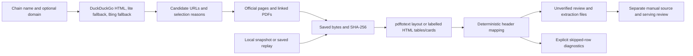

# Offline chain nutrition PDF finder

**TL;DR:** Find official nutrition sources, extract deterministic review drafts, and replay saved evidence without database or model access.

This is a research script, outside `apps/` and the production ingestion path.
Discovery uses public website GET requests only.
Local-input and replay modes make zero network requests.
No mode imports a database client, model SDK, credential loader, or production service.
Every nutrition row has `status: "unverified"`; there is no verification or approval option.



## Run

Use the repository's installed Node 20+ dependencies, including `tsx` and `parse5`.
PDF extraction requires Poppler's `pdftotext` on `PATH`.
On macOS, install it with `brew install poppler` if needed.
There is no Node PDF library in this checkout, so a missing `pdftotext` produces an actionable error and discovery can try a supported official HTML source instead.
Nothing installs packages or reads `.env` files at runtime.

Run from the repository root:

```sh
# Search and download: the domain is optional but recommended.
npm run eval:pdf-finder -- --chain "Wahoo's Fish Taco" --domain wahoos.com --out /tmp/wahoos-nutrition-new

# A chain name may also be the first positional argument.
npm run eval:pdf-finder -- "Claim Jumper" --domain claimjumper.com --out /tmp/claim-jumper-new

# Fully offline extraction of an already downloaded official source.
npm run eval:pdf-finder -- --chain "Example Chain" --input /path/to/nutrition.pdf --source-url https://example.org/nutrition.pdf --out /tmp/example-chain-new

# Fully offline replay; verifies the saved source's hash and byte length first.
npm run eval:pdf-finder -- --replay scripts/eval/pdf-finder/demo/wahoos --out /tmp/wahoos-replay-new

# Show ten randomly selected source excerpts without displaying extracted target macros separately.
# Supply the printed seed again to reproduce exactly the same selection.
node --import tsx scripts/eval/pdf-finder/sample.ts scripts/eval/pdf-finder/demo/wahoos
node --import tsx scripts/eval/pdf-finder/sample.ts scripts/eval/pdf-finder/demo/wahoos cac436a998e09abe6d0eccb9c76679cf
```

`--out` must name a new directory whose parent already exists.
Even an existing empty directory is refused to preserve prior evidence.
The equivalent workspace entrypoint is `npm run eval:pdf-finder -w scripts -- ...`.
`--input` requires `--source-url`, which identifies the original published URL without fetching it.
`--replay` is exclusive with chain, domain, input and source URL arguments.
Replays retain the original discovery history and copy the selected source; ancillary search/download paths in that history refer to the original run.

## Discovery and selection

The query is `<chain name> nutrition pdf`.
The script tries DuckDuckGo's HTML endpoint, its lite HTML endpoint, then Bing HTML until it sees a chain-domain candidate.
HTML challenges, empty results and provider errors are recorded before fallback.
Search results are extracted from DDG result anchors or Bing result headings, with tracking redirects decoded locally.
Search-result ads and arbitrary unrelated links are excluded.
Every extracted result URL and every discovered nutrition/PDF link is retained in `discovery.json`, including rejected third-party candidates.

The domain hint establishes the preferred chain domain, with a hostname boundary check that rejects lookalike suffixes.
Without a hint, name/acronym resemblance supplies a tentative domain preference, not proof of ownership.
Third-party results remain audit entries and are not selected automatically.
A PDF hosted elsewhere can become a candidate when directly linked by an official-domain page.
The script parses the non-JavaScript HTML view, including PDF links inside `noscript`.
No browser, JavaScript execution, authentication or challenge bypass is used.

Ranking adds 100 for a preferred/inferred official source, 20 for nutrition/PDF wording, 30 for a PDF URL, and 45 for an official-page link.
Allergen-only documents lose 60.
The first successfully parsed source in descending score order wins, with URL order breaking ties.
Each candidate retains its score, reasons, discovery locations and download/parse outcome.
The chosen source has an explicit selection reason; discovery and a successful parse never establish freshness or factual approval.

Discovery is bounded to three search providers, five official-page inspections, and twelve ranked source attempts.
Each GET has a 15-second timeout, a 20 MiB body limit and at most five redirect requests.
Only HTTP(S) website URLs without embedded credentials, literal IP addresses, local hostnames or custom ports are supported.
Redirects are revalidated; a changed domain cannot silently inherit official-domain authority.

## Files and compatibility

| File | Purpose |
| --- | --- |
| `manifest.json` | Selected URL, raw SHA-256, byte length, extraction method, text SHA-256, item and diagnostic counts |
| `discovery.json` | All candidate URLs, origin links, ranking reasons, failures and chosen-source explanation |
| `search/*.html` | Exact search responses with hashes in the discovery receipt |
| `downloads/*` | Original downloaded PDF/HTML bytes, including inspected official pages |
| `source.txt` | Layout-preserving PDF text or normalized HTML nutrition table with original HTML line references |
| `review.json` | Catalog-shaped unverified draft with item provenance and diagnostics |
| `extraction.json` | Legacy extraction-shaped unverified rows for source-review workflows |
| `failure.json` | Actionable failure if discovery or extraction cannot complete |

The base review shape mirrors `apps/api/services/chainCatalogs/waba-yoshinoya-2026-09.json`: `version`, `reviewedBy`, `changes`, `quarantine`, and each change's `slug`, `canonicalKey`, `expected`, `facts`, `source`, `locator`, and `aliases`.
`facts` uses the existing `calories`, `proteinG`, `carbsG`, `fatG`, `servingSize` names, while `source` uses the existing `url` and `sha256` names.
Published decimals are preserved, without rounding to the production catalog's integer calorie requirement.
When no serving is published, `servingSize` stays `null` instead of inventing a portion.
Explicit quantities in an item name, such as `10 servings`, are retained without rescaling the source macros.

Drafts add `status: "unverified"` and `provenance`, keep `reviewedBy: null`, and leave all aliases empty.
Provenance records the original item name, section, physical PDF page, 1-based text line span, raw excerpt and review notes.
PDF line numbers restart on each form-feed-separated physical page; Wahoo's printed page 1 is physical page 2 because of its contents page.
For HTML, `page` is `null`, line spans locate `source.txt`, and notes additionally locate the original HTML lines.
HTML source hashes always cover the original HTML bytes, not the normalized table.
Repeated item names get a deterministic page/line suffix instead of being silently merged.

`extraction.json` mirrors the hand-checked `apps/api/tests/fixtures/__snapshots__/chain-batch-source-extraction.json` rows consumed by `scripts/eval/jev-macro/build-truth.ts`: brand, page, section, name, serving, the four camel-case macros, canonical key, fact status and reason.
`serving` is the published gram quantity when one is explicit; the complete serving label is also preserved as `servingSize`.
Every extracted row uses `factStatus: "unverified"` as well as `status: "unverified"`, with its URL, SHA-256 and locator attached.
These deliberate draft fields and nullable serving/reviewer keep the strict production approval schema from accepting this output directly.
Do not feed drafts to a database writer or replace the existing approved truth set.
Separate source inspection, serving resolution, contextual menu bindings and the repository's approval process are still required.

## Parsing boundaries

PDF parsing recognizes column order from headers, never the chain name or expected macro values.
The current profiles cover Wahoo's eleven-column protein-before-carbs layout, Claim Jumper's calories/fat/carbs/protein layout with optional vitamin columns, and simple fully labelled space-aligned tables.
HTML supports ordinary tables with explicit nutrient headers and static label/value accordion cards such as Old Spaghetti Factory's.
Saturated fat, calories from fat and sodium cannot stand in for total fat, calories or protein.
Wrapped item names are joined within their page, while sections and regional availability headings remain attached.
Missing, negative, malformed, ranged and less-than target macros are skipped with diagnostics rather than replaced with zero or a guessed point value.
Ragged and spanning HTML rows, and unsupported PDF headers, also abstain.
Suspect published calorie/macro arithmetic gets a review note and is never silently corrected.

There is no OCR, serving reconstruction, macro estimation, menu matching, automatic current-menu filtering or general-purpose arbitrary PDF table understanding.
A file may include components, catering portions and regional appendices; item counts count published rows rather than unique LA menu dishes.
The demo retains Wahoo's Fresno, Las Vegas and New Jersey sections distinctly, and Claim Jumper's catering and banquet sections distinctly.
Scanned PDFs, unknown layouts and JavaScript-only nutrition without a usable HTML/PDF fallback need separate inspection.

## Validate and inspect

```sh
npm run test:pdf-finder -w scripts
npm run type-check -w scripts
npm run lint -w scripts
git diff --check
```

Tests cover real PDF text snippets, HTML tables/cards, wrapped and digit-prefixed names, section/portion preservation, malformed macros, search wrappers, domain preference, non-JavaScript official links, offline CLI/replay, source tampering, overwrite refusal, and all three pinned demos.
The demo checks bind every row to its raw text locator and recheck thirty independently transcribed four-macro tuples.
Tests make no web, model or database calls and do not require Poppler.
For an HTML spot check, reopen the original downloaded HTML card and read its named labels; the normalized `source.txt` row alone is not independent evidence of the HTML parser's correctness.

If search returns a challenge, inspect `discovery.json` and the saved response before rerunning.
The supported recovery is another configured HTML endpoint or `--input` with the downloaded official source, without repeatedly fetching a blocked URL.
Wahoo's first failed discovery exposed a missing `noscript` fallback link; the current HTML parser and discovery regression test cover that actual entrypoint.
An offline workspace lockfile refresh also encountered an unrelated uncached mobile peer dependency.
The existing installed npm Arborist virtual-lock API regenerated only this workspace's already-present `parse5` dependency metadata, without a registry request or changes to application dependencies.

See [demo results](demo/README.md) and [source spot checks](demo/spot-checks.json).
