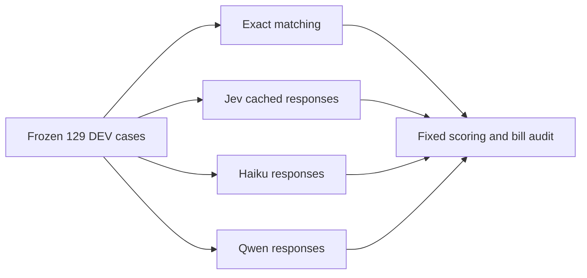

**TL;DR:** All methods use the frozen 129-case DEV sample; new inference spend is $0.45402165.

# Haiku and Qwen DEV sample comparison

Generated from the committed-source run, original preflight, predictions, raw exchanges and additive spend ledger.
The sample contains 34 curated matching, 25 curated macro, 44 bulk matching and 26 bulk macro cases.
The original `modelSelection` chose these IDs before any paid output, with a $2.69768053 reservation under the $2.70 stop and $3 hard cap.
The ordered selection SHA-256 is `3ec69529643a0253f95c4e04f927fe0d157c2d9fef14891af309962015a4fa70`.
Source head: `a2ea9d394e3c76417a00d56d1b7d8e6fd45998f7`; final run: `2026-10-27T08-03-39-011Z-0135102d`.
Every matching method completed the same 78 matching cases, and every supported estimator completed the same 51 macro cases.
Exact has no macro estimator, so its macro measurements are explicitly unavailable.
No holdout evaluation or database connection is part of this comparison.

## Matching

| Tier | Method | Pass | Wrong matches | Recall | Abstain |
| --- | --- | ---: | ---: | ---: | ---: |
| curated | exact | 31/34 (91.2%) | 0/34 (0.0%) | 13/16 (81.3%) | 0/34 (0.0%) |
| curated | jev-v3 | 28/34 (82.4%) | 1/34 (2.9%) | 13/16 (81.3%) | 5/34 (14.7%) |
| curated | haiku | 25/34 (73.5%) | 6/34 (17.6%) | 15/16 (93.8%) | 3/34 (8.8%) |
| curated | qwen | 30/34 (88.2%) | 3/34 (8.8%) | 15/16 (93.8%) | 0/34 (0.0%) |
| bulk | exact | 41/44 (93.2%) | 0/44 (0.0%) | 28/31 (90.3%) | 0/44 (0.0%) |
| bulk | jev-v3 | 38/44 (86.4%) | 0/44 (0.0%) | 27/31 (87.1%) | 4/44 (9.1%) |
| bulk | haiku | 42/44 (95.5%) | 1/44 (2.3%) | 31/31 (100.0%) | 1/44 (2.3%) |
| bulk | qwen | 39/44 (88.6%) | 0/44 (0.0%) | 26/31 (83.9%) | 3/44 (6.8%) |

Pass requires the exact expected ID or explicit NO MATCH.
Wrong counts returned IDs that differ from the expected match; missed positives reduce recall.
Abstentions and invalid outputs fail the pass metric.

## Macro estimation

| Tier | Method | N | Median error % Cal/P/C/F | >50% calorie error | Zero correct | All four within 25% | Failed cases |
| --- | --- | ---: | --- | ---: | ---: | ---: | ---: |
| curated | exact | 25 selected | N/A | N/A | N/A | N/A | No estimator |
| curated | jev-v3 | 25 | 27.1/28.6/21.7/25.0 | 4/25 (16.0%) | 12/12 (100.0%) | 4/25 (16.0%) | 0 |
| curated | haiku | 25 | infinity/infinity/infinity/infinity | 18/25 (72.0%) | 10/12 (83.3%) | 1/25 (4.0%) | 14 |
| curated | qwen | 25 | 91.1/75.9/100.0/50.0 | 14/25 (56.0%) | 10/12 (83.3%) | 0/25 (0.0%) | 9 |
| bulk | exact | 26 selected | N/A | N/A | N/A | N/A | No estimator |
| bulk | jev-v3 | 26 | 26.6/50.0/46.8/34.1 | 6/26 (23.1%) | 8/10 (80.0%) | 1/26 (3.8%) | 0 |
| bulk | haiku | 26 | infinity/infinity/infinity/infinity | 21/26 (80.8%) | 8/10 (80.0%) | 1/26 (3.8%) | 16 |
| bulk | qwen | 26 | 66.7/100.0/95.0/75.0 | 15/26 (57.7%) | 8/10 (80.0%) | 2/26 (7.7%) | 8 |

Percent error uses absolute error divided by truth, with exact zero required for zero truth.
Against zero truth, zero prediction has 0% error and any nonzero prediction has 100% error under the frozen metric.
Zero correctness counts individual zero-valued macro fields, rather than whole meals.
The calorie miss threshold is strictly greater than 50%, and all-four success requires each error to be at most 25%.
Failures count as infinite error and calorie misses; medians include them.
Known invalid model answers remain failed outcomes, without normalization, a new prompt or a paid retry.

## Cost and latency

| Tier | Method | Attempted cases | New USD/1k cases | Recorded request USD/1k | Execution p95 ms | Original request-total p95 ms |
| --- | --- | ---: | ---: | ---: | ---: | ---: |
| curated | exact | 34 | 0.0000 | 0.0000 | 0.1 | N/A |
| curated | jev-v3 | 59 | 0.0000 | 0.0745 | 10.2 | 299.6 |
| curated | haiku | 59 | 3.7915 | 3.7915 | 8.4 | 10020.0 |
| curated | qwen | 59 | 0.3662 | 0.3662 | 9.0 | 60777.4 |
| bulk | exact | 44 | 0.0000 | 0.0000 | 0.1 | N/A |
| bulk | jev-v3 | 70 | 0.0000 | 0.0730 | 8.8 | 264.5 |
| bulk | haiku | 70 | 2.7411 | 3.5779 | 7.5 | 8934.7 |
| bulk | qwen | 70 | 0.2406 | 0.3261 | 34445.0 | 152666.0 |
| both | exact | 78 | 0.0000 | 0.0000 | 0.1 | N/A |
| both | jev-v3 | 129 | 0.0000 | 0.0737 | 9.6 | 278.7 |
| both | haiku | 129 | 3.2215 | 3.6756 | 7.7 | 9109.5 |
| both | qwen | 129 | 0.2981 | 0.3445 | 11.2 | 92788.0 |

New USD/1k includes all actual bills from the initial and continuation runs, including failed answers, divided by the selected supported cases.
Recorded request USD/1k sums original response usage costs for the requests consumed by those same cases, including both estimator stages and replayed inputs.
It is a request-equivalent reference cost, rather than another charge or a new call to a provider.
Execution p95 measures the final runner and includes replay reads.
Original request-total p95 sums retained original request durations within each case, including both stages where called; it excludes current replay savings and some runner overhead.
Jev is entirely replayed, and Haiku is replayed in the final continuation, so their execution p95 is not a fresh-provider benchmark.
Retained original request timings were collected at different times and are descriptive measurements, not a controlled current latency benchmark.
Exact timing covers matching only; no exact macro cost or latency is implied.

## Spend and evidence

Actual new inference spend: **$0.45402165**, comprising Haiku **$0.41557200** and Qwen **$0.03844965**.
Exact and Jev add $0.
Historical Jev spend remains $0.12394053; cumulative suite spend is $0.57796218.
The audit reconciles 312 distinct paid model inputs, zero repeated paid inputs, zero new Jev requests, no pending reservations and no unknown usage.
The complete original ledger prefix is preserved.
The two HTTP 400 rejections are retained with their original unknown settlements and additive zero-inference reconciliation receipts.
One Qwen body timed out at 60 seconds; its output remains failed and its $0.00070390 charge is allocated from the sole unresolved request in stable same-key usage counters, within the original reservation.
The before/after lifetime delta matches the daily total, and the two post-timeout reads were unchanged for 289.436 seconds.
This allocation uses aggregate billing evidence; that response has no recovered token-level usage or output.
A second Qwen body timed out at 180 seconds; its retained header generation ID identifies an exact $0.00080546 cancelled-generation bill with 1,054 prompt and 1,292 completion tokens.
Both missing outputs remain failed, and the observed timeout durations are censored latency measurements.
Later unseen Qwen inputs use a 300-second deadline at the same token/price ceiling and preserve generation IDs before body reads.
Anthropic rejected the original macro grammar during schema compilation; shared internal definitions preserve the exact expanded schema and required output constraints.
OpenRouter initially selected a GMICloud endpoint that rejected the model as deprecated; a same-key, same-day zero-usage read independently confirms that rejection added no charge.
Qwen then uses the same model on `deepinfra/fp8`, with fallbacks disabled and the original price ceiling.
This provider and quantization are comparison limitations, as are the providers' constrained-generation transport differences from Jev.
The questions, state projections, bins, targets and final decoder remain unchanged.
The sample is small and deterministic, spans correlated candidate pairs, and supports DEV comparison rather than holdout generalization or production adoption.

Evidence: [canonical summary](summary.json), [predictions](predictions.jsonl), [bill and sample audit](comparison-audit.json), [source and selection](run.json).
Provider contracts: [Anthropic structured outputs](https://platform.claude.com/docs/en/build-with-claude/structured-outputs), [Anthropic pricing](https://platform.claude.com/docs/en/about-claude/pricing), [OpenRouter routing](https://openrouter.ai/docs/guides/routing/provider-selection), [current-key usage](https://openrouter.ai/docs/api/api-reference/api-keys/get-current-key).
