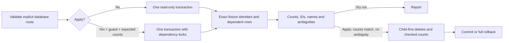

# Fixture cleanup

`cleanup-test-fixtures.ts` inventories the exact fixture families created by `apps/api/tests/db/chainPilot.db.test.ts` and `chainCatalogExpansion.db.test.ts`.
It loads no environment files and never includes connection strings in output or errors.
Supply a database URL through an environment variable, using a read-only credential for shared-database discovery.

```sh
node --import tsx scripts/maintenance/cleanup-test-fixtures.ts --url-env=dev_db_readonly_url
```

The default dry run lists counts and every matching ID/name, store ID, menu source ID, catalog key and parent link in one repeatable-read transaction whose first statement is `SET TRANSACTION READ ONLY`.
`ambiguous` lists fixture-like rows that lack the full identity or have user-owned references.
No address or chain name alone authorizes deletion.

| Family | Exact generated identifiers |
| --- | --- |
| Pilot brands | UUID v4 scope immediately followed by `waba-grill` / `yoshinoya`; display name is scope + ` WaBa Grill` / ` Yoshinoya`; `detectionConf=high` |
| Expansion brands | Same scoped slugs; display name equals the scoped slug; `detectionConf=high` |
| Captured April restaurants | `Captured fixture`; name is scope + space + captured restaurant name; `storeUuid` is scope + captured restaurant ID; matching scoped brand link |
| Expansion variants | `Captured variant`; name equals scoped slug; random UUID v4 restaurant ID; `storeUuid` is scope + the single random UUID v4 menu item ID; matching scoped brand link |
| Pilot rollback restaurant | `Rollback fixture`; name equals pilot WaBa display name; `storeUuid` equals scope; matching scoped WaBa brand link |
| Pilot new locations | `New hex fixture`; name equals pilot display name + ` (New Location)`; `storeUuid` is scope + brand ID |
| Expansion new locations | `New hex fixture`; name equals scoped slug + ` (New Location)`; `storeUuid` is scope + `new-` + chain slug |
| Checkpoints | UUID v4 `runId` equals a verified fixture brand scope, `count=1`; `hexId` equals `runId` + chain slug (pilot) or the bare chain slug (expansion) |

Every restaurant also requires `source=ue_feed`, `lat=34`, `lng=-118`, and the expected brand ID (or an unlinked new location before persistence).
The 31 captured April restaurant IDs/names and 64 menu IDs/names are in `apps/api/tests/fixtures/__snapshots__/chain-pilot-april.json`; the pilot prefixes those menu IDs with its scope.
The 168 positive-count expansion observation variants are in `chain-batch-observations.json`; their restaurant and menu UUIDs are generated at execution.
New-location menus come from `chain-pilot-ue.json` (seven dishes) and `chain-batch-ue-{waba-grill,yoshinoya}.json` (82 and 80 items); persisted provider IDs remain in `MenuItem.sourceItemId`.
Catalog keys are allowlisted per suite and chain from `chainPilotData.ts` (changes and quarantine) and `chainCatalogs/waba-yoshinoya-2026-09.json` (expected baseline and additions).
The discovery regex is anchored to the complete UUID v4 plus one of the two literal chain slugs; deletion uses only the discovered exact primary keys, with no `LIKE` predicates.

`MenuItem` and `MacroEstimate` are owned through exact fixture parent IDs.
`Restaurant.brandId` is the chain link; there is no separate link table in the schema.
`SavedItem` references are listed without user identifiers and always block apply because neither suite creates bookmarks.
No users, subscriptions, targets or unrelated pipeline records are deleted.
Orphan checkpoints without a verified fixture brand scope remain ambiguous and prevent apply.

To apply, review a fresh dry run and pass its complete seven-table `counts` object as `--expect` alongside `--apply`.
Every count must match before any deletion, and every explicit delete count must match afterward or the entire transaction rolls back.
Ambiguities abort apply.
Apply briefly locks all seven tables against concurrent writes, with a five-second lock timeout, then deletes nutrition, menus, restaurants, catalog rows, brands and checkpoints in one serializable transaction.
Use a maintenance window for apply on a shared database.
The existing `db-target-guard.ts` additionally requires `FITSY_ALLOW_PROD_WRITE=1`, `--prod`, and GitHub Actions or the pinned production deployment for production mutation.
Those guard requirements do not grant permission to mutate production; this task authorizes production discovery only with an explicitly read-only credential and never authorizes production apply.

Run `scripts/maintenance/cleanup-test-fixtures.test.ts` for database-free identity, argument and real CLI production-refusal regressions.
`apps/api/tests/db/cleanupTestFixtures.db.test.ts` exercises the SELECT-only dry run, count refusal, exact deletion, ambiguity refusal and rollback against the verifier's owned disposable database.
If that database cannot start, preserve the startup diagnostics (including Docker `OOMKilled` when relevant), keep its resource and target guards intact, and select the database-free regressions locally through `scripts/verify/focused-tests.mjs`.
The normal hook consumes that selection; required database coverage remains pending until trusted PR Verify runs it successfully.


