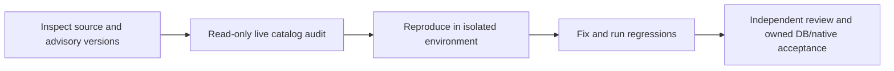

# Security audit helpers

**TL;DR:** Run catalog audits read-only and keep security validation distinct from release acceptance.

`supabase-audit.sql` inspects public-table RLS, client grants, default grants and Storage configuration without selecting user records.
Run it against an explicitly selected target with `psql "$SECURITY_AUDIT_DATABASE_URL" --set=ON_ERROR_STOP=1 --file=scripts/security/supabase-audit.sql`.
It starts a read-only transaction and uses a bounded statement timeout.
Do not apply migrations, change policies or create fixtures on production during an audit.

The existing verifier discovers `scripts/verify/security-schema.test.ts` through the scripts workspace and `apps/api/tests/db/security.db.test.ts` through the API workspace.
The latter checks the migrated catalog against the Prisma model inventory and preserves a real server read.
It also exercises the audit's exact grant query against synthetic ACLs in a read-only transaction, including PUBLIC, anon and authenticated grants.
The audit reads catalog ACLs because `information_schema.role_table_grants` excludes PUBLIC privileges.
Missing database execution is a skipped check, never evidence that a migration works.
Use the canonical owned-database verifier for that stage.

When the worker sandbox denies Docker, listeners or outbound registry access, retain the failed command and continue nondependent inspection and tests.
Use an already authenticated browser for the requested GitHub report and read-only Supabase inspection when those supported tools are available.
Never move credentials into the worker or weaken the existing production/ownership checks.
The existing delivery owner resumes blocked DB, native and advisory checks in its supported environment.

In Supabase's Monaco editor, replace the entire document using Select All and paste.
Filling its virtual textarea can insert text at the caret instead of replacing the document.
Verify the query before Run and retain any failed SQL attempt as evidence.
Do not save OAuth redirect URLs or credentials in audit artifacts.

Source scans and a keyless export do not establish that a configured release bundle or all historical secrets are clean.
Run full-history gitleaks with redaction, the live dependency advisory scan and the actual release-configuration checks before declaring those surfaces accepted.
