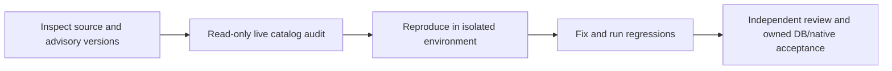

# Security audit helpers

**TL;DR:** Run catalog audits read-only and keep security validation distinct from release acceptance.

`supabase-audit.sql` inspects public-table RLS, client grants and grantors, effective PostGIS metadata privileges, default grants and Storage configuration without selecting user records.
Run it against an explicitly selected target with `psql "$SECURITY_AUDIT_DATABASE_URL" --set=ON_ERROR_STOP=1 --file=scripts/security/supabase-audit.sql`.
It starts a read-only transaction and uses a bounded statement timeout.
Do not apply migrations, change policies or create fixtures on production during an audit.



The existing verifier discovers `scripts/verify/security-schema.test.ts` through the scripts workspace and `apps/api/tests/db/security.db.test.ts` through the API workspace.
The latter checks the migrated catalog against the Prisma model inventory and preserves a real server read.
It also exercises the audit's exact grant query against synthetic ACLs in a read-only transaction, including PUBLIC, anon and authenticated grants.
The audit reads catalog ACLs because `information_schema.role_table_grants` excludes PUBLIC privileges.
Its PostGIS section follows extension membership, including an installation outside `public`, and reports schema access separately from table and column privileges.
The effective privilege functions include PUBLIC and inherited roles; a raw table grant alone does not establish Data API access.
PostgreSQL 17 and later also report the SQL-only MAINTAIN privilege.
Missing database execution is a skipped check, never evidence that a migration works.
Use the canonical owned-database verifier for that stage.

## PostGIS metadata boundary

The read-only production catalog review for [#577](https://github.com/dgmolla/fitsy/issues/577) on 2026-10-28 confirmed the following before remediation:

| Property | Observed state |
| --- | --- |
| Metadata and extension owner | `supabase_admin`; PostGIS 3.3.7 in `public` |
| Schema owner | `pg_database_owner`, inherited by the database owner `postgres` |
| Client schema USAGE | Granted to PUBLIC, anon and authenticated |
| anon/authenticated table privileges | SELECT, INSERT, UPDATE, DELETE, TRUNCATE, REFERENCES, TRIGGER, MAINTAIN |
| Metadata RLS | Disabled; no production write was attempted |
| `postgres` authority | Schema owner privileges; no table SELECT or UPDATE grant option |

SELECT, INSERT, UPDATE and DELETE map to the ordinary Data API read and mutation operations when `public` is exposed.
TRUNCATE, REFERENCES, TRIGGER and MAINTAIN are SQL privileges, not ordinary REST table operations.
The catalog establishes privileges, not a successful production mutation or personal-data exposure.
No production grants, policies, extension ownership or data were changed by this audit.

Migration `20261029000000_private_public_schema` closes client schema USAGE, including PUBLIC's implicit access, while preserving explicit server-role grants from `20261028120000_pipeline_writer_roles`.
It runs as the existing schema owner and rejects inherited client USAGE atomically instead of accepting a partial restriction.
It neither changes PostGIS objects nor transfers ownership or enables RLS on extension metadata.
An extension upgrade may retain or recreate table grants, but these cannot restore client schema USAGE.
After deployment, rerun the audit: client `schema_usage` must be false even if the extension-owned `table_privilege` remains true.
The migration queues Supabase's supported `NOTIFY pgrst, 'reload schema'` on commit because previously resolved statements can retain object references after a schema-permission change.
PostgREST's schema reload also [recycles its connection pool](https://github.com/PostgREST/postgrest/blob/v14.10/src/PostgREST/AppState.hs).
Verify the reload and fresh Data API requests before recording platform adoption; if the platform listener is unavailable, the existing host owner must recycle the Data API connections through supported platform controls.

This is an ownership/RLS exception for built-in coordinate definitions, not an exception allowing public Data API access.
Fitsy uses Supabase clients for Auth and Prisma for application data, with no direct Data API table or RPC consumer.
Retaining the platform-owned metadata table, its grants and its schema preserves PostGIS transformations and avoids an extension rebuild.
See [Supabase's PostGIS guidance](https://supabase.com/docs/guides/database/extensions/postgis#security-advisor-flags-publicspatial_ref_sys) and [PostgreSQL schema privileges](https://www.postgresql.org/docs/17/ddl-schemas.html#DDL-SCHEMAS-PRIV).
If a target's schema owner cannot remove inherited access, stop the migration and use the existing platform owner to remove `public` from exposed schemas or disable the unused Data API through [Supabase's supported configuration](https://supabase.com/docs/guides/api/securing-your-api#disable-the-data-api).
Never take ownership of the extension to work around that failure.

`apps/api/tests/db/postgisMetadata.db.test.ts` reproduces client reads, insert/update/delete and SQL-only TRUNCATE in rolled-back disposable fixtures, then verifies denial after the actual migration runs under a non-extension owner.
It also checks inherited column grants, atomic refusal of inherited schema grants, unchanged extension ownership/ACLs, PostGIS transforms and backend Prisma reads.
These rolled-back fixtures disable Prisma's statement cache to model fresh Data API sessions; they do not prove that a live PostgREST listener consumed the notification.
It runs through the existing focused-tests check and API database suite, without a new registry, workflow, hook, environment variable or simulator journey.
Keep the writer inventory in the focused recipe so it checks the actual audit SQL and fixture datasource construction before publication.

```sh
node scripts/verify/focused-tests.mjs --set scripts/lib/db-writer-inventory.test.ts scripts/verify/security-schema.test.ts apps/api/tests/db/security.db.test.ts apps/api/tests/db/postgisMetadata.db.test.ts
npm run verify -- --stage=cheap
```

When the worker sandbox denies Docker, listeners or outbound registry access, retain the failed command and continue nondependent inspection and tests.
Use an already authenticated browser for the requested GitHub report and read-only Supabase inspection when those supported tools are available.
Never move credentials into the worker or weaken the existing production/ownership checks.
The existing delivery owner resumes blocked DB, native and advisory checks in its supported environment.

In Supabase's Monaco editor, replace the entire document using Select All and paste.
Filling its virtual textarea can insert text at the caret instead of replacing the document.
Verify the query before Run and retain any failed SQL attempt as evidence.
Do not save OAuth redirect URLs or credentials in audit artifacts.

Source scans and a keyless export do not establish that a configured release bundle or all historical secrets are clean.
Run full-history gitleaks with redaction, the live dependency advisory scan and the actual release-configuration checks before declaring those surfaces accepted.
